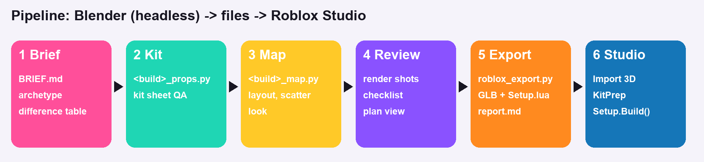
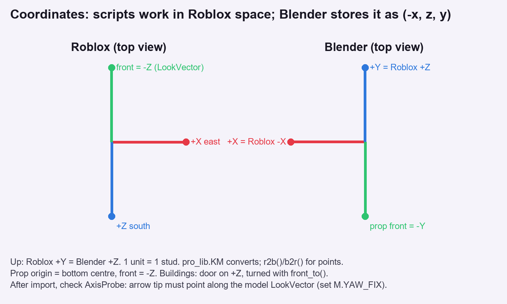

# Roblox Map Builder (Blender, scripted, Roblox-ready)

> Part of roblox-map-builder. Proprietary, see `LICENSE.md` (personal use by the licensee; no redistribution).
> Maps and assets you make with it are yours. Version history: `CHANGELOG.md`.



Builds a complete map in **headless Blender** from Python: a prop kit (`<build>_props.py`), a layout + scatter + look
script (`<build>_map.py`), preview renders you LOOK at, then a Roblox export (`scripts/roblox_export.py`) that writes
importable meshes and a generated setup ModuleScript. 20 worked example maps plus a tree set, with renders, plans
and sample exports (`examples/`).

| Read | When |
|---|---|
| `references/map_archetypes.md` | before every brief: pick a layout type not used before, fill the difference table |
| `references/layout_patterns.md` | planning the layout (annotated plans of all examples, numbers per archetype) |
| `references/prop_cookbook.md` | building the kit (primitives, recipes, kit sheets) |
| `references/palette_and_look.md` | palette + lighting (palette strip, colour lessons, Roblox look mapping) |
| `references/quality_checklist.md` + `bug_gallery.md` | every render review (before/after images of real bugs) |
| `references/roblox_pipeline.md` | export, Studio import, Studio-tested upload add-on route (section 12), orientation check, collision, lighting, budgets |
| `references/coastal_town_look.md` | diorama-stage style guide: data-driven setup, material slots, tiers, symmetry, palette, light |
| `references/stylised_trees.md` | building a hero / filler tree: skinned skeleton trunk + roots, overlapping leaf masses, turntable review |
| `references/realistic_trees.md` | ONLY when semi-realistic alpha-card trees are requested (opt-in exception to "no alpha cards"): Trunk/Branches/Leaves MeshParts + SurfaceAppearance |

## 0. Rules
- **Roblox space in every script**: X east, Y up, Z south, 1 unit = 1 stud, front = -Z. `pro_lib.KM` converts to
  Blender `(-x, z, y)`. Avatars ~5.5 studs (check the game: some scale characters).
  
- **Roblox-compatible from the first line**: prop origin = bottom centre (pivot), one solid mesh + one mesh per glow
  key, colour only from the palette strip (UVs 0..1, 512 px), no alpha cards, no photo textures, no text in meshes,
  <= 20,000 triangles and <= 2,048 studs per mesh (the exporter splits ground/horizon, warns on props).
- Triangle budgets are HARD (phone performance). The exporter fails (exit 1, `EXPORT_FAILED`, `## Budget OVER` in
  report.md) when the map is over budget: whole map <= 450k placed tris (`--budget`), one prop <= 12k (`--prop-budget`),
  1-3 landmarks named by `--hero <regex>` <= 30k (`--hero-budget`), all static chunks <= 150k (`--static-budget`). Fix by
  cutting: fewer bevel segments, delete faces nobody sees (bottoms, backs against walls), lower-res far trees, fewer
  rim/back-slope copies, a Sky instead of a modelled horizon. Never raise a budget or pass `--allow-over` unless that
  was explicitly requested. Check the budget while building (map_stats.json), not only at export. Single models (bosses,
  characters) follow the same spirit: <= 40k tris total, every MeshPart <= 20k.
- Placement is checked HARD too (fails the export; table in references/roblox_pipeline.md "7b"): EVERY non-rock prop
  with > 5% of its body inside a rock, cliff, static chunk or another prop (foliage > 8%); every prop whose lowest
  point floats > 0.5 over the surface under its footprint (foliage 1.0; `--float-ok` for props that hang on purpose);
  water with no bed within 8 studs or edges standing above the bank; waterfalls without a lip and a pool; collision
  rules that make no sense (foliage colliding, walk-through props on hull, water with a hull, walkable statics nobody
  can stand on, paths blocked by a colliding prop); with `--cliff-buffer N`, anything built, planted or walked within
  N studs of a cliff foot. Cliffs are ONE connected wall (tiers of fused masses, buried foot, talus), never a grid of
  separate pillars, and the foot is fitted round the village with a clear buffer (examples/valleylake `FOOT_NEED`).
  Place trees with a raycast to the real top surface, then test clearance against every solid prop and the cliff
  mesh before keeping a spot. Never bypass with `--no-clip-check` unless explicitly requested.
- Detail without triangles (how to stay under budget AND look rich; report.md ranks where the triangles go and flags
  props over 600 tris per stud):
  - Put small detail in the painted atlas and normal maps (cracks, grain, tiles, trim lines, window frames), not in
    geometry. Model only what changes the silhouette.
  - Segment counts by size: bevels 1 segment (2 only on heroes); cylinders 6-8 sides under 2 studs, 12-16 on big round
    forms. Tiny props (< 3 studs) stay under ~400 tris.
  - Spend on what the camera sees close: heroes, stations, the spawn view. Repeated scatter (rocks, walls, bushes) is
    where totals explode: keep it low per copy, and give far/back-row copies a cheaper variant.
  - Delete faces nobody sees while modelling (bottoms of grounded props, faces buried in walls or the ground).
  - Reuse kit meshes (memory is paid once) and let KitPrep's RenderFidelity Automatic handle distance LOD.
  - Don't count on an export-time decimator: a lossless coplanar merge saved ~0 on these scripted maps, and any looser
    tolerance warped the ground (tested on the example maps).
- Build headless: `"${BLENDER:-blender}" -b --factory-startup --python <build>_map.py` from the build folder. Never
  open another .blend in an interactive Blender session that is in use (unsaved work, upload add-on login).
- Original geometry only: no Toolbox, no generated meshes, no invented asset ids, no flags/banners.
- Preview in Blender first. Export is safe any time (files only); importing into a place happens only on request, and
  uploads go through Studio import or the Blender upload add-on in a logged-in interactive session.
- **Every map is a different game and must look and play vastly different** (layout grammar, terrain, traversal,
  scale, kit, look, hero: >= 5 of 7 differ from every earlier map). New prop kit per map. The examples teach METHOD.

## 1. Brief (`BRIEF.md`)
Game + archetype, size, spawn point + facing, ONE hero visible from spawn, 3-5 districts or play areas, path network,
palette (3-5 bases + 2-4 accents, named by material), look (time of day, sky, haze), "not this" list, and the
difference table against every earlier map. Templates: `examples/*/BRIEF.md`.

- **Define the palette sheet before building** (every map): base ramps with a value structure, ONE dominant glow family + ONE accent, per-district accents, swatch sheet `previews/palette.png` + table in `BRIEF.md`. Method: `references/palette_and_look.md` "Colour palettes"; worked example `examples/cavemap/cave_palette.py`.

## 2. Prop kit (`<build>_props.py`)
- Start from `examples/sugarworks/sugar_props.py` (imports the grove machinery: `Prop`, `S`, `materials`, `to_kit`;
  replaces `PAL`, `GLOW`, `GLOW_E`). Primitives: `scripts/pro_lib.py` + example helpers (`blob`, `dome`, `sphere`,
  `torus`, `stripes`, `arch_*`, `bool_diff`). Recipes and kit sheets: `references/prop_cookbook.md`.
- Each prop = function returning a `Prop`, built at y = 0, front -Z, name unique per variant (`Fence12_t0`).
- Anything that meets the ground extends BELOW its origin (posts -0.3, props -0.4, trunks/roots deeper).
- Openings are cut (hollow the host, then `bool_diff`), never painted. Clearances computed, not guessed.
- **Model quality bar (non-negotiable):** judge every prop in `scripts/prop_studio.py` close-ups (one prop per
  700-900 px image, front + back) BEFORE it enters a map. A kit sheet or map shot is too small to catch crude models.
  Reject: bare boxes / single spheres / flat plates, no bevels, one colour per prop, parts floating or poking through,
  blocky joints. Require: bevelled parts, a layered silhouette (base + body + top detail), 3+ materials from the
  palette, real joints (elbows, sockets, collars), secondary detail (trim, rivets, planks, coins, gems) and props
  built from smaller props. See `references/bug_gallery.md` (model quality) and `prop_cookbook.md`.
- Kit sheet (`scripts/kit_sheet_template.py`) is for checking scale and the set as a whole, after the close-ups.

## 3. Layout (`<build>_map.py`)
Order (see any example's `build()`), annotated plans in `layout_patterns.md`:
1. `H(x, z)`: one height function for the ground mesh AND placement (hills / plateaus / flat plots / carved water).
2. Paths and play areas (polylines with widths, plots via `local()`), `keepout` / `on_hard` for scatter.
3. Hero + set pieces by hand (`face`, `front_to`), reserved in `PTS`.
4. Reserve camera spots (`CAMS`) and the spawn -> hero vista BEFORE scatter.
5. Scatter: containing wall/rim, clusters (odd counts), story groups, verge detail. Seeded `random.Random`.
6. `place()` grounds on the LOWEST point of the footprint minus a sink, never centre height.
7. Ground mesh LAST; `horizon()` outside the playable box (skirt ring, distant shapes, clouds).
8. Render a top-down plan (`scripts/render_plan.py` + `annotate_plan.py`) to check the layout as a whole.

## 4. Look + renders
Gradient sky, low sun (15-35 deg) with a colour that suits the map, AgX Punchy, thin haze (0.00015-0.0007), matte
palette material. Shots: spawn (player eye), overview, one per district / play area, hero close-up, a close-up of every
constructed detail. `previews/map_stats.json` = instance + triangle counts. Details: `palette_and_look.md`.
**Photoreal look (when the user asks for real-looking maps):** model real objects, map palette ramps to Roblox materials
(`--materials`), and add a render-only Cycles pass (`examples/warehouse/wh_real.py`: smooth by angle, Bevel node,
PBR per Roblox material, a real light per lamp prop, physical sky + sun, a volume haze box, DOF). It never saves the .blend.

## 5. Review loop (mandatory)
Read every render and the plan. Run `quality_checklist.md`; compare with `bug_gallery.md`. Iterate until it passes,
then report with the renders.

## 5b. Stud / Parts mode (low-poly stud games: +1 simulators, obbies, tycoons in the classic look)
When the game's style is Roblox studs (blocky Parts with a stud texture), build with `scripts/blocks.py` instead of
meshes: every prop is a `BlockProp` of Parts (`b(size, pos, col, v, rot, mat='stud'|'neon'|'smooth', shape='block'|
'wedge'|'cyl'|'ball', tr)`), placed with `transformed()`, previewed with `mesh_blocks()` + `stud_material()`
(procedural studs) and written as real Parts with `write_rbxmx()` (Glacier + a stud MaterialVariant, Neon for glow).
No uploads: File > Insert from File, then a short setup snippet (MaterialVariant + Lighting +
SpawnLocation). Match the target game first: read its Parts (sizes, materials, MaterialVariant ColorMap) read-only
through the Studio MCP. Worked example: `examples/plusspeed/` (+1 Speed Run, 10.7k Parts). `prop_studio.py` renders
BlockProps too. **No bare blocks:** rule: a prop that is only plain cubes / squares is rejected. Use the detail helpers in `examples/plusspeed/plus_props_v3.py`: `chamfer_block`
(wedge-bevelled tops), `octo` (8-sided columns), `cyl_v` (round parts), `ring` (tangent blocks in a circle),
`gable` (wedge roofs), `framed_panel`, `bulbs_frame` (marquee bulbs), and real display items (`speed_shoe`, `potion`,
`gift`, `barrel`) instead of coloured cubes.
**Concept first (v4, `plus_props_v4.py`):** learn a good map's build style and placement, never copy its layout or
pieces. One theme pushed into every prop; one signature edge detail repeated on every ledge (e.g. a race kerb);
one landmark closing the main view; one shared station base. Hero props are pixel-art silhouettes from stepped
blocks (`pixel_art` / `raster`: outline rim proud, fills inset, glow pixels as neon). **Never build text, letters or
digits from Parts**: names and labels are BillboardGuis added in Roblox; use icons (bolt, star, shoe) instead.
Pixel art must read from the side players stand on (front = -Z, flip the yaw for track pieces seen from the hub).

## 6. Export to Roblox
```bash
"${BLENDER:-blender}" -b <map>.blend --python <skill>/scripts/roblox_export.py -- --name <MapName>
```
Writes `roblox/`: `kit/*.glb` (one Model per prop), `static/*.glb` (split ground/horizon), `AxisProbe.glb`,
`<Name>Setup.lua` (rows + `Build()` + `ApplyLook()`), `<Name>KitPrep.lua` (collision fidelity), `manifest.json`,
`report.md` (limits, budgets, collision table, warnings). `--materials` = a Roblox material per object (Grass, Wood, Rock, Slate,
Foil ...) instead of the palette texture, see `roblox_pipeline.md` section 11. Read `report.md`; fix warnings that are not notes.
Collision rules for a map's own prop names go in `collision_rules.json` next to the .blend (`{"rules": [[regex, kind], ...]}`,
kind = none | box | hull | precise; checked before the built-in list; or `--collision <file>`). Never edit the exporter for one map.
Studio steps: Import 3D into `ServerStorage.<Name>Kit` (studs, pivot at origin) > ModuleScript > KitPrep >
AxisProbe check (`M.YAW_FIX`) > `require(...).Build(kit, workspace)` > `ApplyLook()`. Or upload through the
Blender "Upload to Roblox" add-on and assemble the kit from the returned ids (Studio-tested, `roblox_pipeline.md`
section 12). Full guide: `roblox_pipeline.md`. Sample output: `examples/sugarworks/roblox_sample/`.

## Files
- `scripts/pro_lib.py` - palette, shading, mesh accumulator, primitives, output helpers (Roblox-space bmesh).
- `scripts/prop_studio.py` - close-up QA renders per prop (front + back) + contact sheet. Use for every prop.
- `scripts/kit_sheet_template.py` - auto-framed kit overview sheet (scale / set check).
- `scripts/render_plan.py`, `scripts/annotate_plan.py` - top-down plan + numbered legend.
- `scripts/roblox_export.py` - Roblox export, Luau generation, validator (mesh maps).
- `scripts/roblox_materials.py` - Roblox material per palette ramp: Blender preview + `material_map.json` for `--materials`.
- `scripts/blocks.py` - stud / Parts mode: BlockProp, procedural stud preview material, .rbxmx Part writer.
- `examples/whispering_grove/` - forest hub bowl (props, kit sheet, map, brief).
- `examples/frostpeak/` - village; building methods (`front_to`, level pads). Re-skin anti-pattern: do not copy layout.
- `examples/sugarworks/` - tycoon plots (identical plots via `local()`), candy-industrial kit, sunset; `roblox_sample/`.
- `examples/skyrise/` - zone simulator on floating sky islands (polar island tops, modelled undersides, bridges +
  zone gates, sim stations, resource nodes, 4 biomes, Trophy hero), early-morning look; `roblox_sample/`.
- `examples/plusspeed/` - +1 Speed Run: straight zone-strip runner in low-poly stud style, all Parts (.rbxmx), 8 themed
  zones (meadow .. space), hub with treadmills / hatchery / shop / rebirth / leaderboard, finish trophy.
- `examples/moonclean/` - Moon Sweepers: clean-the-moon sim in a terraced crater (polar height function, shelf rings
  stepping down to a rocket on the central peak, ramp + airlock per ring, beacon-rail lips, hub deck outside the rim,
  mess props per zone), black starry sky; `roblox_sample/` + `SETUP.md` (moon look, gravity, spawn snippet).
  Surface roughing: small craters are modelled lathe props (`crater`, per-vertex tones) in a shallow dish carved in `H` (craters cut into a coarse ground grid look pixelated), riser walls jittered radially, and a
  `--materials` export (Sand / Slate / Basalt / Snow regolith) so the ground has real texture in Roblox.
- `examples/medievalbattle/` - Riverfield Siege: mirrored PvP arena (two keeps on plateaus across a river; bridge chokepoint with a
  broken-spire hero tower, chapel isle, ford with wattle trenches), ashlar panels (`ashlar`/`ashlar_ring`: inset blocks + mortar),
  real cut openings, canonical-face `merge()`, roads as draped ribbon meshes + smooth per-vertex ground (no grid stair-steps); `roblox_sample/`.
- `examples/onsenvillage/` - Yumori Springs: tiered diorama stage (`coastal_town_look.md`: one beauty camera over water, terraces climbing away, mirrored about x = 0, pagoda hero on the axis), `flared_roof` (lofted Asian roofs: concave rise, upturned corners, tile corrugation), cut windows/doors (`holed_wall`), golden-hour look + preview steam volumes; `roblox_sample/` + `SETUP.md` (lighting, steam ParticleEmitters).
- `examples/fishcenter/` - Tidehook Lagoon: fishing-sim hub as a radial ring lagoon on stilts (ring boardwalk + 4 spokes to a
  lighthouse rising out of a glass aquarium dome, station pads outside the ring, fishing piers with railing-gap cast spots,
  reef islets frame), layered fringed thatch (`thatch_band`/`thatch_hip`/`thatch_cone`/`thatch_gable`), lofted boolean boat
  hulls with paint lines on section rows, see-through Glass preview, generated `Hooks.lua` of invisible gameplay anchors
  (stations, sell, fishing spots, fish zones, boat spawns) from `anchors.json`; `roblox_sample/` + `SETUP.md`.
- `examples/canyonbazaar/` - Sunspire Canyon Bazaar: LINEAR canyon run (one meandering floor, spawn plaza > gated market street > palm oasis > narrows > temple court) cut into a mesa plateau; one `H` with stepped strata walls (`wall()`: riser > walkable ledge y 24 > riser > shelf > mesa top), strata shaded by STEP (not per-face height jitter, which streaks vertically), a side loop up carved stairs, along the ledge and over a rope bridge, flagstone paving ribbons + ring plazas, a Petra-style hero standing in a rectangular niche CUT into the sheer end wall (stepped surround + strata courses, not a ring of boulders), crisp dusk look (warm gold key + cool blue fill, very light haze: heavy warm haze turned everything one muddy orange), stretched-flat shade cloths (no flags); blank sign faces + `hooks.json` station points; `roblox_sample/` + `SETUP.md`.
- `examples/creaturelab/` - Bloomcrest Care Centre: INTERIOR-FIRST hub for a creature-collecting game (round care hall with stations on the wall ring + an axial research wing ending in the Bloom Chamber hero; small exterior forecourt + spawn plaza). Curved walls as angular cells with cut openings (`arc_wall` / `ring_seg`), roofs as separate no-collision props (third-person camera reads the interior; cutaway renders hide them), polar + checker inset floor tiles, original capsule / emblem shapes (no franchise designs), `Hooks.lua` (heal slots, counters, PCs, starters, doors); `roblox_sample/` + `SETUP.md`.
  Catch ball (`catch_ball`, original design): two thick lathe shells (outer cap + bevelled rolled rim + a hidden plug, or an open inner surface for the half-open variant) meeting at a seam TILTED 20 deg, so it never reads as a band-and-button ball; a raised pill latch with a glowing gem + light ring at the front, hinge knuckles + leaves at the back; tier trims as `sphere_decal` inlays (a 2D poly gnomonic-projected onto the sphere, given thickness): stripes, chevron, star, small paw. Painted shading per vertex (light top, dark underside, a spec spot toward a fixed key light); per-FACE palette column (never mix columns inside a face: rainbow smears). LODs 0 / 1 / 2 (~1.6-2k / ~1k / ~250 tris) picked by size, so shelves full of balls stay cheap; open shells rotate about the hinge line before the tilt.
- `examples/eggplots/` - Eggstead Isle: "Steal a ___" egg map, LOW POLY flat-shaded. Two facing rows of 4 identical plots across a conveyor lane on a lake island; plot-local `plot()` placed 8x with per-accent kit variants (only the accent props differ), fences as runs of 8/4 with posts, a cracked-egg hatchery hero whose tunnel is boolean-cut through its base to feed the belt, low drain so the spawn keeps the hero sightline, tagged hierarchical `Hooks.lua` (Plot<N>/Gate/OwnerSign/CollectPad/EggSlot1..10, Conveyor path points, shops); `roblox_sample/` + `SETUP.md`.
- `examples/valleylake/` - Mistvale Lake: hidden valley BOWL round a turquoise lake, matched to a reference image (flat floor, draped beach ring, dock, islet with a leaning hero tree, waterfall cleft + stream, timber-and-shoji gable houses, stalls, lantern rope lines). Shows: a SOLID cliff wall of carved rock masses (`rounded_mass` superellipsoid + soft cut planes + flat bedded bottom, `rim_shade` convexity highlights, `moss_cap` on top ledges only) grounded on the lowest point of their footprint over a dark painted backing cone; a hand-painted-look 1024 ATLAS shared by every mesh (`paint.py`: palette column -> painted block, shade -> block row, planar projection -> block x, installed by patching `mesh_from`), exported WITHOUT `--materials` so the texture rides along; trees as a Skin-modifier skeleton (trunk, limbs, ground-hugging roots, bark furrows) under overlapping random-leaf masses merged into one crown (`references/stylised_trees.md`, 4-angle `turntable.py`), hero tree split trunk + canopy under the 20k MeshPart cap, needle-card conifers; foliage placed LAST against a BVH of the real geometry (the exporter's clip/float test, jittered retries, cliff-top trees only on raycast flat ledges); Standard view + cyan volume haze + `post.py` bloom; `SETUP.md` with Lighting / Atmosphere / Bloom / ColorCorrection / water / mote values and how the atlas loads; `Hooks.lua`.
- `examples/voidrealm/` - The Shattered Void: ORBITAL RING of six obsidian shards round a black-hole singularity (hero) in an endless starry void; rune bridges (hexagon ring road), a floating stepping-stone jump run, a gravity lift to a high Starwatch shard. Shows: faceted shard islands as one polar top grid + jagged keel rings + stalactite hulls (static), inward-facing stations so the hero is always in view, `void_paint.py` (re-skins valleylake's painted atlas by monkeypatching `paint_block` / `PERIOD`), glow-first night look (dark world, stars + nebula shader, lavender key + cyan rim, thin violet haze), hanging crystals set into keel undersides (origin at top), tagged `Hooks.lua` (stations, prompts, portal, lift, arena, step stones, hazard, killzone); `roblox_sample/` + `SETUP.md`.
- `examples/cavemap/` - Glowroot Caverns: UNDERGROUND hub (vaulted cavern round a lake that glows from below, five tunnels to station grottos). Shows: an enclosed cave shell = voxel-remeshed union of air ellipsoids, displaced into strata ribs, normals into the air, split walls (precise) / vault (no collision) + a coarse outer crust so the sun only enters a slanted shaft; floor heightfield with holes for a chasm and a lift shaft; wall-distance raster for placing rocks at wall feet; hanging props (vines, stalactites, glow-worms) hung under the LOWEST ceiling point; glowing fungi grounded per MeshPart with foot nodules; a palette module + swatch sheet (`palette_sheet.py`) and before/after; `post_export.py` (map collision rules + no auto lights), `Hooks.lua` with 30 curated PointLights; `roblox_sample/` + `SETUP.md`.
  Ores (`cave_ores.py`): an ore heap is a lumpy dome + graded angular host lumps with per-face ore seams (3D noise), blocky ore
  crystals set into seam faces (some glowing), banded crystal druses fanning from one root, a real shovel + pickaxe; same load in carts.
- `examples/towncity/` - Maple Junction: CITY GRID town hub (boulevard + streets + kerbed blocks, town square with fountain, clock-tower town hall hero on the spawn axis, walk-through train station closing the boulevard vista, shop row + back alley with fire escapes, bank, open car-dealer hall, skyline ring). Shows: ONE parametric facade generator (`building()`: piers + spandrels round real openings, recessed glass, sills/lintels/frames, string courses, cornice brackets, parapet, rooftop tanks/AC/antennas/sheds, shopfront with BLANK fascia + striped awning, fire escapes, `lite` back-row variant) giving 12 building kits; `city_paint.py` atlas with TRUE 2D tiles (brick, stucco, clapboard, shingles, asphalt, slabs) whose faces are clipped at the tile period so texture never stretches; lofted cars / bus / train; footprint overlap check; road-path + NPC hooks; 421k tris; `roblox_sample/` + `SETUP.md`.
- `examples/petsim/` - Puffpaw Isles: HAPPY CHIBI pet-collecting sim as an ISLAND CHAIN in a lagoon (hub isle + 3 zone isles curling round it, climbing 5 > 7 > 12 > 18, humped bridges with toll-gate arches). Shows: polar layer-cake islands (grass top, icing lip with per-face drips, sponge cliff + jam stripe), smooth-shaded chibi kit with `soft()` gradient + lit-side shading, `bubble_crown` puffball trees (core ball + fibonacci bubbles), a mascot statue fountain with decals laid on the head along its surface normal, hero split under the 20k MeshPart cap (`PetFountain` + `PetStatue` at one origin), 126 cheap breakables (< 300 tris) placed as clustered props + `Breakable_Z<z>_<nn>` hooks with Zone / Tier / Kind; `Hooks.lua`, `SETUP.md`.
- `examples/dunedesert/` - The Gilded Dunes: OPEN-WORLD RADIAL DUNE SEA (sandstone ruin city + six-tier step pyramid hero in the open centre, six POIs on spokes: caravan camp shop, palm oasis, obelisk field, half-buried colossus head, walk-under wyrm rib arches, sunken temple dungeon down a walled stair trench), transverse dunes from one `H` (asymmetric crest profile, wandering phase, ridge ring frame) kept cheap (8-stud grid, 42k tris) with wind ripples in a re-skinned painted atlas (`dune_paint.py` monkeypatches valleylake's `paint.py`: sawtooth ripple block, consistent projection axes, tiny ping-pong on sand so ground shows no z bands), compacted darker path shade + waystones, temple trench cut in `H` with extra grid lines on the wall planes, realistic alpha-card date palms (`gen_trees.py` palm species), dig mounds tier 1-3 + `Hooks.lua`; high-noon look; `roblox_sample/` + `SETUP.md`.
- `examples/candyland/` - Sugarcrest Kingdom: BOARD-GAME TRAIL candy hub (straight Royal Road + two winding loops of coloured candy tiles with sprinkles, round tile "stops" at each station, a chocolate river from Fudge Falls crossed three different ways: waffle bridge / biscuit bridge / marshmallow jumps, gingerbread castle with ice-cream-cone towers in a jelly moat, gumdrop-mountain frame). Shows: smooth confection kit (`lathe` with profile-driven normals, `soft` subdivided puffs, `striped_tube` = helical stripes by twisting the geometry, `swirl_disc` = true spiral lollipop bands, `closed_torus` (an open `tube` loop leaves a seam), `icing_cap` / draped hill caps with gaussian round-tipped drips + rolled lip), board tiles draped as separate strips, per-kind preview materials mirroring `--materials` (Glass candy, Sand cookie, SmoothPlastic frosting, Snow ground); flat-shade any part that must stay ONE MeshPart in materials mode (jelly glass) or the 8-part merge swallows it; `roblox_sample/` + `SETUP.md` + `Hooks.lua`.
- `examples/warehouse/` - Northgate Distribution: PHOTOREAL interior (one steel hall: high-bay pallet-rack aisle grid, cross aisle
  under an overhead bridge crane carrying a shipping container (hero), dock floor with 7 roller-shutter docks, a two-level
  mezzanine with stair + office, bulk floor, and a truck yard 4 studs below with trailers, a cab-over tractor and a weld-mesh
  fence). Shows: real-object kit built for the budget (rack bay ~3k tris with lite pallets + decal quads, `tricount.py`),
  Roblox materials per ramp (`--materials`), `cull()` of unseen faces with a hanging-prop exemption, `collision_rules.json`,
  and the Cycles photoreal pass `wh_real.py`; `roblox_sample/` + `SETUP.md`.
- `examples/oaktrees/` - realistic alpha-card tree set (`gen_trees.py`: oaks, birch, sapling, hero oak, flowering
  tree, three firs, street trees; Trunk / Branches / Leaves MeshParts + SurfaceAppearance, painted textures, turntable
  sheets); imported by valleylake, towncity and dunedesert.
- `scripts/contact_sheet.py` - front | back contact sheet of prop_studio renders (system Python + PIL).
- `references/images/` - plans, kit sheets, bug pairs, palette, axes, pipeline; `images/src/` regenerates them.
- `references/screenshots/` - perspective renders of each example.
- `LICENSE.md` - proprietary license. `CHANGELOG.md` - version history.

Environment: example shell scripts call `"${BLENDER:-blender}"` (set `BLENDER` to the Blender executable if it is
not on PATH) and `"${PYTHON:-python}"`; every path is relative to the skill folder.
