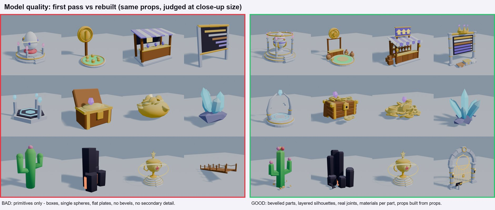
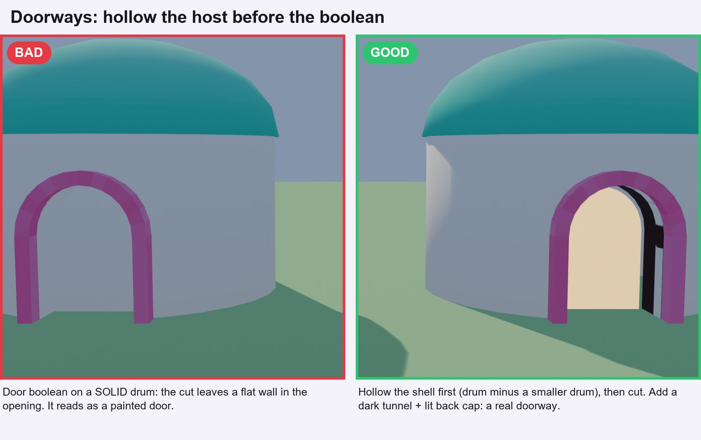
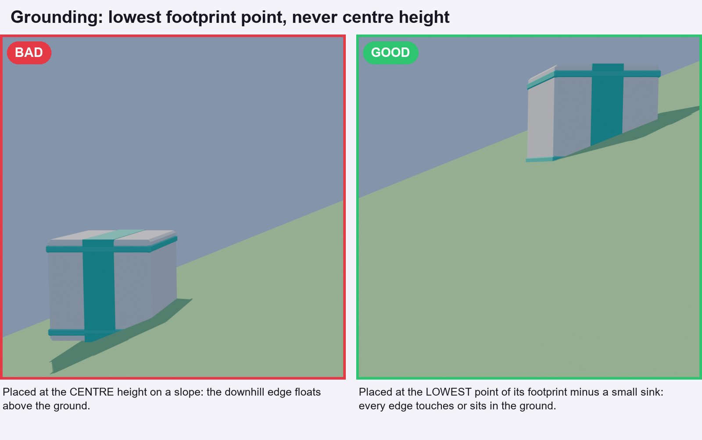
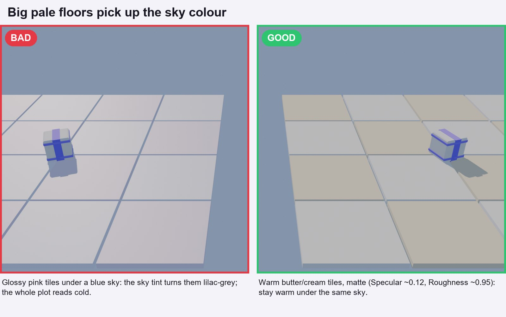
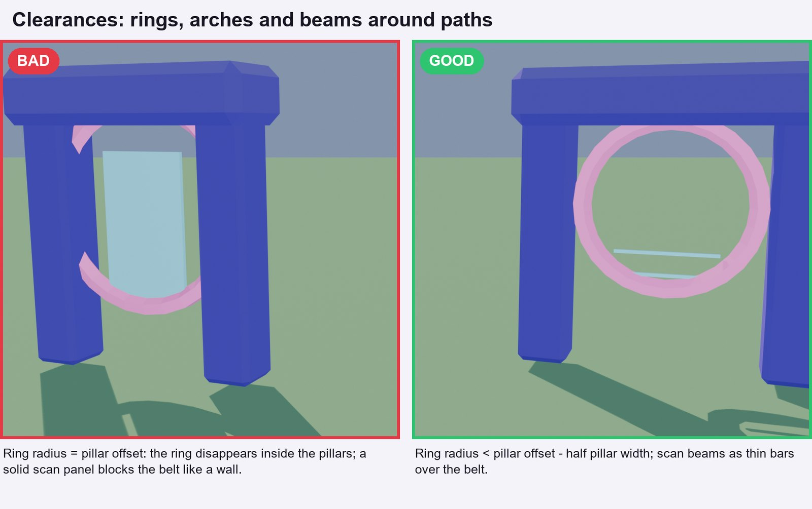
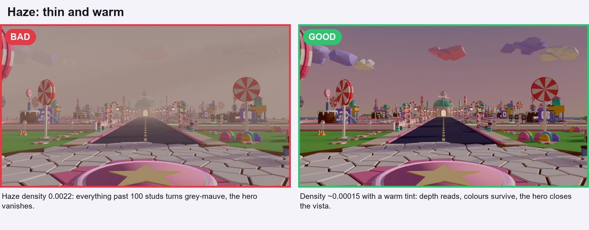

# Bug gallery: what goes wrong, what it looks like, the fix

Each pair was rendered by `images/src/gallery.py` (and `haze.py` on the Sugarworks map), labelled by `compose.py`.
Re-run them after changing a helper to confirm the fix still holds.

## Crude models (the most important one)

What happened: the first Skyrise kit was built from bare primitives and only checked on a small kit sheet and in map
shots, where a box with a gem on it looks "fine". Up close every prop was crude. Fix: `scripts/prop_studio.py`
close-ups for every prop, and the model quality bar in `SKILL.md` (bevels, layered silhouette, 3+ materials, real
joints, secondary detail, props built from props). The rebuilt props are in `examples/skyrise/sky_models*.py`.

## Doorways painted on instead of cut

Fix: hollow the host, then boolean the arch prism, add frame + dark tunnel + back cap; cut/hollow any band that wraps
the host. (Whispering Grove's elder tree first had a flat glowing plate; Sugarworks' Exchange first had a flat wall.)

## Props floating on slopes

Fix: `place()` grounds on the minimum of `H` over the footprint ring (`foot()` = widest base radius), minus a sink of
0.25 x scale, and every prop extends below its origin. Never use the height at the prop centre.

## Pale floors turning cold under the sky

Fix: warm base colours for large pale areas, matte palette material, lower world strength.

## Parts hiding inside each other (clearances)

Fix: compute clearances (ring radius < pillar offset - half pillar width), make beams thin bars, check every machine
from the side on the kit sheet.

## Haze washing the map out

Fix: density 0.00015-0.0007 depending on map size, warm tint at sunset, larger box than the horizon.

## More (from the build logs, see quality_checklist.md)

| Bug | Symptom | Fix |
|---|---|---|
| sRGB hex into a linear shader input | glow renders white | linearise (x^2.2), base 0.45x |
| Camera reserved too small | spawn/district shot starts inside a tree or gate | reserve CAMS with radius >= biggest canopy (14), keep cams on roads |
| Gables pitched the wrong way | triangle hidden inside the walls | `ngon_prism` gable at (-90, 0, 0) |
| Two-slab roof | V-gap shows the interior | ridge beam + ridge cap |
| Awning slat tilt sign | sawtooth of separate rails | tilt matches stacking direction, check from the side |
| One skirt slab over the map | the whole map covered by a dark plane | four slabs in a ring outside the map square |
| Kit sheet rows in front of each other | cameras look through other props | auto-frame each row, stack later rows behind (-Z) |
| Same prop name for two variants | Blender renames to `.001`, Roblox models collide | include the variant in the name (`Fence12_t0`, `Fence7_t0`) |
| Boolean leftovers | zero-area faces in the export | exporter dissolves degenerates on the export copy |
| Map reuses a previous layout | "same map, new colours" | `map_archetypes.md` difference table before the brief |
