# Layout patterns (with plans of the three example maps)

Top-down plans are made with `scripts/render_plan.py` (north up, ortho) and labelled with `scripts/annotate_plan.py`
(spec files in `images/src/spec_*.json`). Render one for every new map: a plan shows dead zones, crowding and broken
sight lines faster than any perspective shot.

```bash
"${BLENDER:-blender}" -b <map>.blend --python <skill>/scripts/render_plan.py -- --center 0 0 --size 470 --out plan.png
python <skill>/scripts/annotate_plan.py spec.json
```

## The universal skeleton

Every map, whatever the archetype, answers five questions in the layout:

1. **Where do I spawn and what do I see?** Spawn faces the hero down a clear vista corridor (reserved before scatter).
2. **Where do I go?** Paths with 2-3 widths (main 16+, side 10-12, trails 6). One main route, branches to districts.
3. **What is each place for?** 3-5 districts, each with one activity and one set piece, readable from its own camera.
4. **Where does the map end?** A soft wall (trees, cliffs, fences, water) inside the playable box, a horizon outside.
5. **What is the one thing I remember?** The hero: biggest, most saturated, on a plateau or at a vista end.

## 1. Hub bowl (Whispering Grove): radial paths into a central plaza

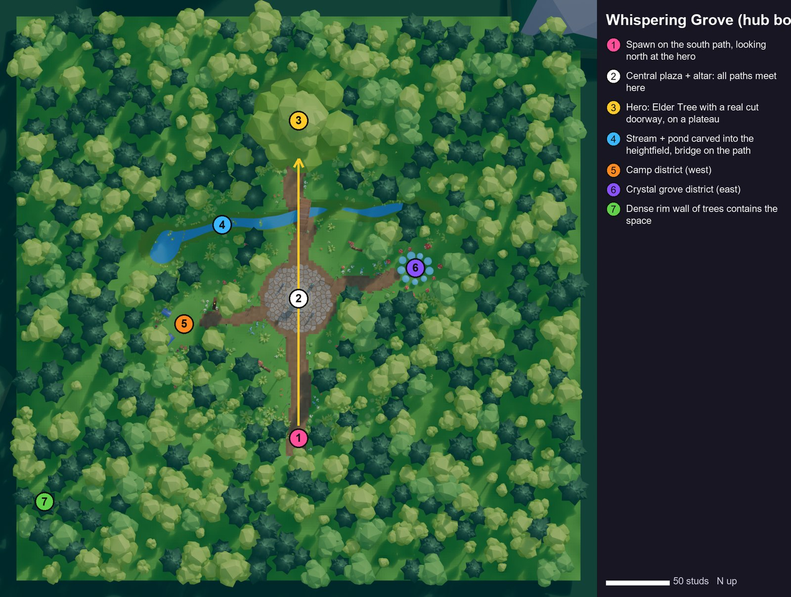

- Heightfield bowl: rim rises at the edge, plaza levelled, hero on a plateau (`lerp` to `ELDER_Y`).
- Four paths meet at the plaza; spawn on the south path looks straight up the north path to the hero.
- Districts sit off the cross (camp west, crystal grove east), each linked by a side path.
- A stream crosses the north path: the bridge is a story beat between plaza and hero.
- Dense rim forest (odd clusters, dark pines + light oaks mixed) closes every edge.

## 2. Village (Frostpeak): streets, buildings facing them

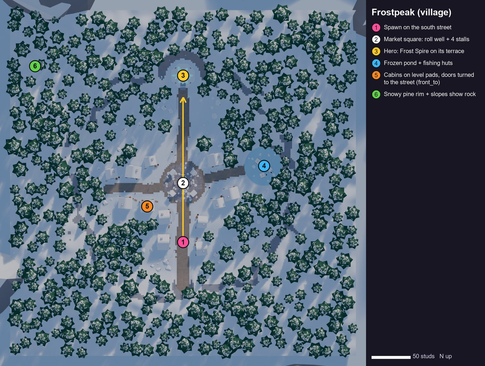

- Same bowl idea but the paths are streets and the plaza a market square; the hero (spire) closes the north street.
- Each cabin sits on its own level pad and turns its door to the nearest street point (`front_to`).
- The pond is a district reached by the east street; huts on the ice face the shore.
- Trees stay out of a vista corridor (|x| < 22 along the north street).
- Lesson: it re-used the grove layout and kit. Different game, same map = the failure the variety rule forbids.

## 3. Tycoon plots (Sugarworks): one boulevard, identical plots

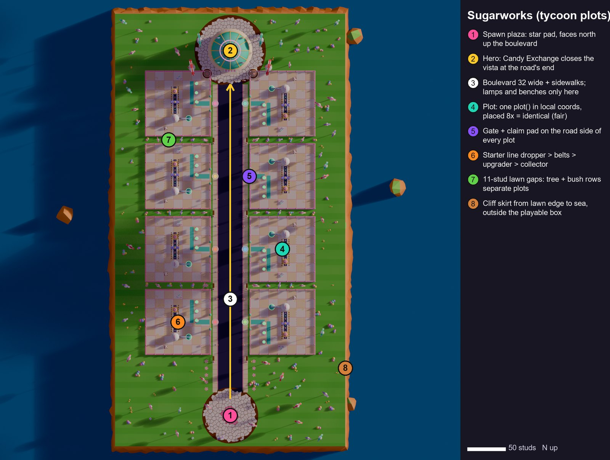

- Flat plateau (no hills: plots must be equal), cliff skirt down to the sea outside the playable box.
- One boulevard north-south; spawn plaza at the south end, the hero closes the north end.
- 8 plots, 2 rows of 4, 84 x 84, 11-stud lawn gaps (tree + bush rows) between them.
- `plot(i, px, pz)` builds every plot in local coordinates (`local()` maps plot-local to world), so all plots are
  identical by construction; only the team glow colour changes.
- Plot contents follow play order from the gate inward: claim pad (outside the gate) > walkway > buy buttons >
  starter line > cash pad > empty slots for the next purchases.
- Street furniture (lamps, benches, bins) only on the sidewalks, aligned to the plot rhythm so nothing blocks a gate.

## 4. Floating sky + zone strip (Skyrise): a rising island chain

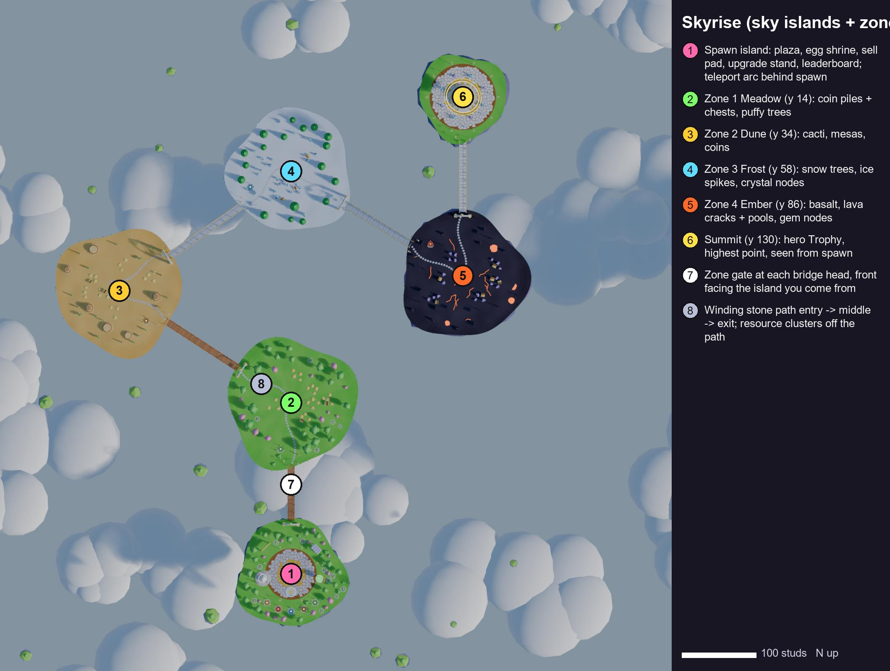

- No ground plane. Each island = polar top mesh (rings x segments, rim radius = `R(1 + .07 sin 3a + .04 sin 5a)`),
  a 0.6 dirt lip, and a modelled underside (`island_under`: shrinking rings to a tip, strata bands, hanging rocks,
  vines, roots and glow crystals). `H(x, z)` returns the island top height inside a rim, `None` outside.
- Islands climb: spawn y 0 -> 14 -> 34 -> 58 -> 86 -> summit 130. The rise is the progression you can see from spawn.
- Bridges run rim to rim (3 studs into each island), built along -Z with a `rise`; each has a **zone gate** at its
  start whose front faces the island you come from, plus lamps at both heads.
- Each zone island: one biome (top colour, trees/rocks on the rim ring 0.55-0.92 R), a winding stone path entry ->
  middle -> exit, 6 resource clusters of 3-5 nodes off the path, a signpost and teleport pad near the entry.
- Spawn island: paved plaza with the stations round it (egg shrine, sell pad, upgrade stand, leaderboard), spawn pad
  facing the first gate, a teleport arc (one pad per zone colour) behind spawn.
- Sky dressing: floating rocks off the bridge lines, a cloud sea ~110 below, far high clouds (keep them away from
  camera spots).

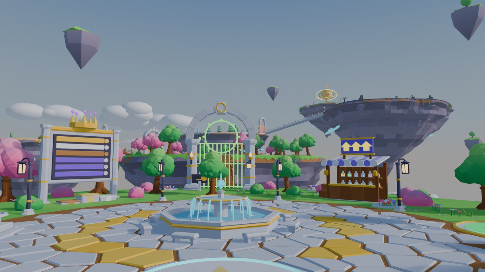
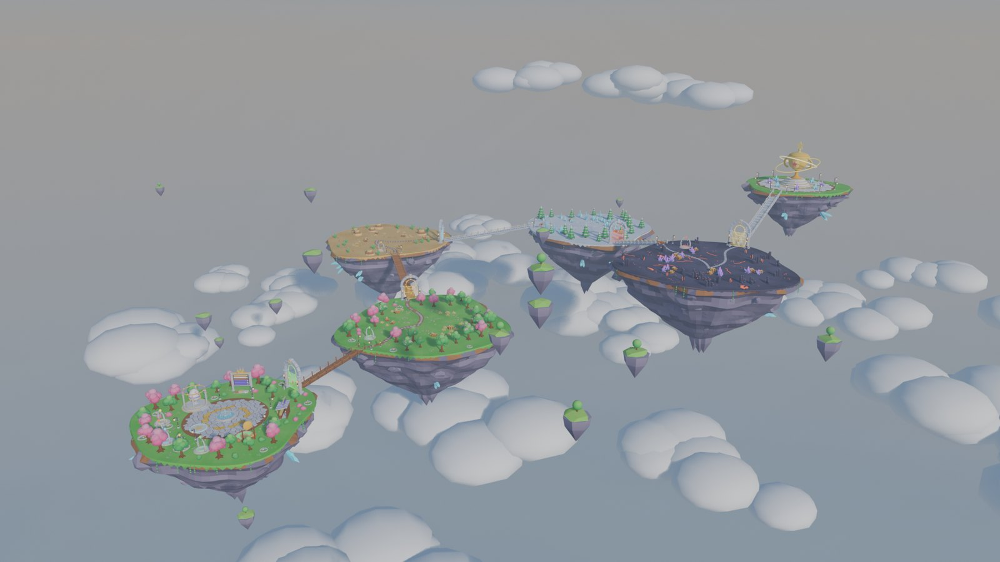

## 5. Zone strip (+1 Speed Run): one straight track, themed zones in a row

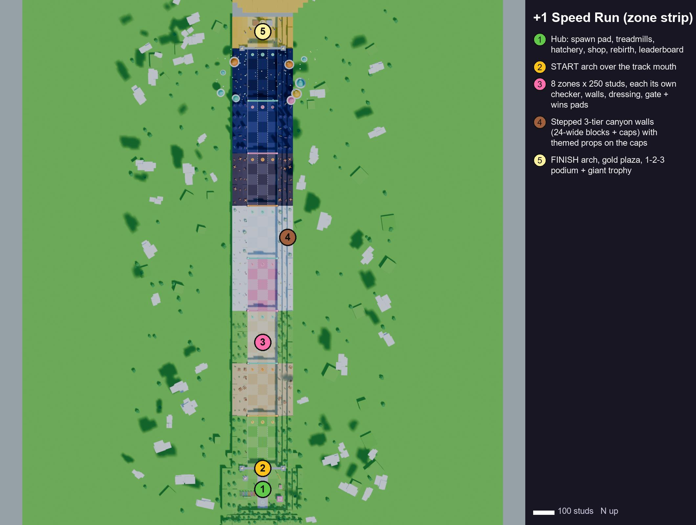

- Typical genre conventions (read a target game's Parts read-only via Studio MCP to match it): 48 x 50 two-tone checker tiles, canyon walls
  of 24-wide rock blocks with 2-stud caps, stacked-cube lamp pillars with neon lanterns, a gate (two lamp pillars, a
  beam, a sign board, a translucent veil) at every zone start, voxel trees on the ledges, ~200-250 studs per zone.
- Track 144 wide = 3 lanes of 48; dashed lane lines + a neon zone line; wins pads (3 across) near each zone end.
- Walls: 3 stepped tiers (30 / 46 / 62 tall), each 24 wide, caps in the zone's accent; dressing on every cap, lamp
  pillars and distance boards on the first ledge. Outer plates at the tier height hide the outside drop.
- Zones change everything at once (floor checker, wall + cap colours, dressing, lamp colours, wins pad colour) so the
  progression reads instantly: Meadow, Desert, Beach, Candy, Snow, Volcano, Neon City (neon window strips), Space
  (planets + stars above the canyon).
- Hub before the track (spawn, training treadmills, hatchery, shop, rebirth, leaderboard), START arch over the track
  mouth, FINISH arch + podium + trophy at the end, end wall closing the view.

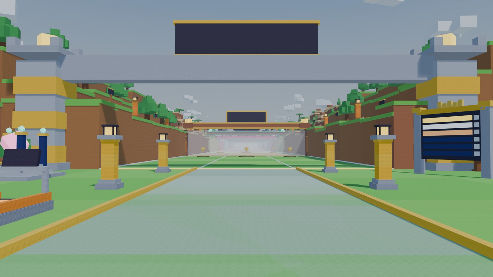
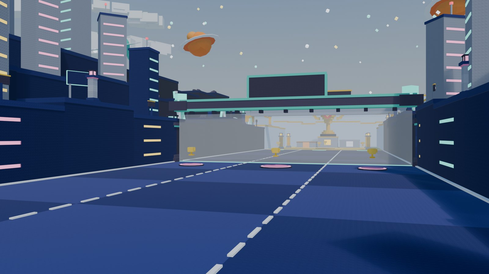

## 6. Terraced crater (Moon Sweepers): shelf rings stepping down to a central peak

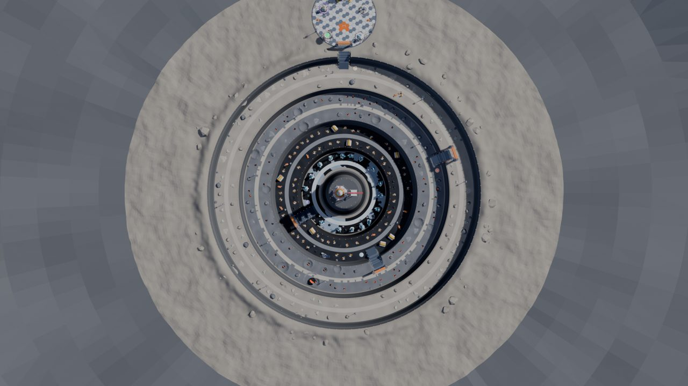

- One height function in POLAR form: `profile(r, a)` = rim crest + hub plateau outside, flat shelves inside, each riser a
  smoothstep 6.4 studs wide, flat-topped peak in the middle. Ramps blend in on top (`ramp_w`: linear drop across the
  riser, width 18, length 1.5 x the drop) and sub-craters are added as bowl + raised rim.
- Rings (radius / floor y): hub plateau outside r 262 (y 8), Z1 205-251 (-12), Z2 145-199 (-34), Z3 92-139 (-58),
  Z4 52-86 (-84), peak flat top r 30 (-40). Shelves 34-46 wide: wide enough for clusters + a ring path + mess.
- Ramp angles spiral round the crater (-90, -20, 65, 150 deg) so every zone is crossed on the way down; an airlock gate
  sits at the head of each ramp, a return jump pad beside each ramp foot.
- The hub is a separate deck OUTSIDE the rim, facing in: the free Gate 1 airlock on its edge frames the rocket from
  spawn. Every shelf gets a lighter trodden ring path at mid radius (orientation from above and from the lip).
- Ground = polar grid (512 angles, radial steps 1.6 at risers / 4 elsewhere) + a coarse horizon skirt to r 2600 with
  distant crater rims. One mesh, split by the exporter into 16 chunks.

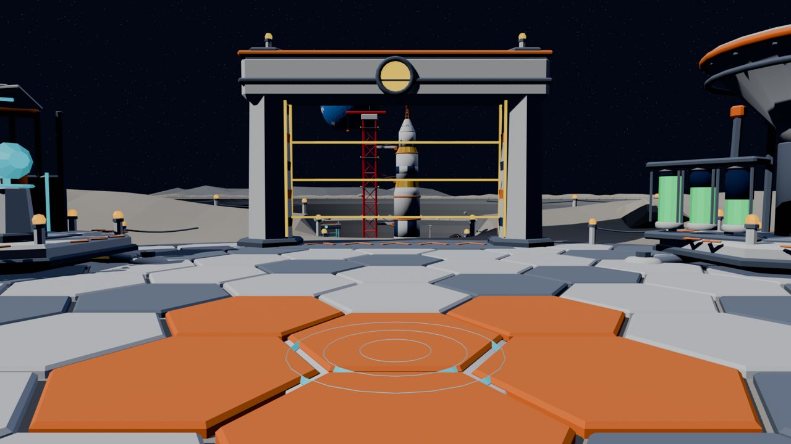
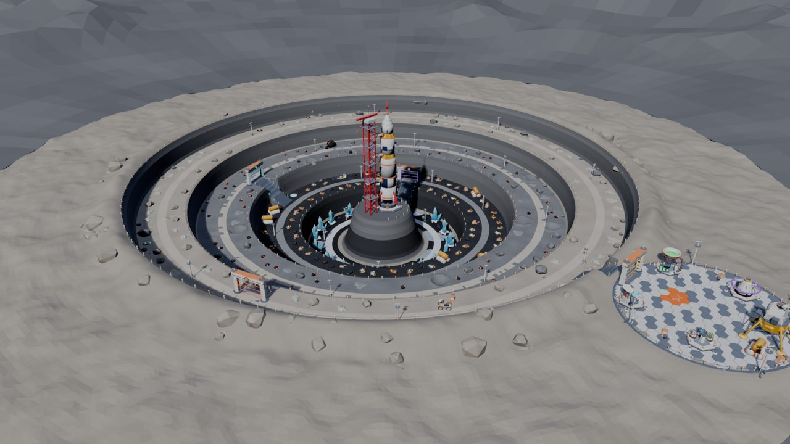

## Layout grammars for the other archetypes (not built yet; see map_archetypes.md)

| Archetype | Skeleton | Key numbers |
|---|---|---|
| Linear obby | spline of stages, checkpoint pads, kill floor, one colour per stage | gaps <= 12 studs flat, rises <= 7 studs (avatar jump ~7.2), stage length 40-80 |
| Vertical tower | stacked floors + spiral ramp or stairs, theme per floor, open balcony views | floor height 16-24, ramp slope <= 30 deg |
| Arena | bounded space, mirrored spawns, cover every ~20 studs, 2-3 height layers | sightlines < 120 studs, cover 4-8 studs high |
| Island chain | water-first heightfield, one district per island, bridges/boats | island gaps 20-60 studs, beaches as soft edges |
| City grid | blocks between streets, building fronts as a kit, alleys, interiors behind doors | streets 24+ wide, block 60-120 |
| Dungeon rooms | rooms + corridors graph, ceilings everywhere, light only from props | corridor 12-16 wide, room 40-80 |
| Race loop | closed spline, banked turns, run-off, infield set pieces | track 40+ wide, curve radius >= 60 |
| Underground | carved caverns, tunnels, glow as the only light | ceiling everywhere, 20-40 tall caverns |

## Placement helpers (copy from the examples)

| Helper | Example file | What it does |
|---|---|---|
| `H(x, z)` | all `*_map.py` | one height function for ground mesh AND placement |
| `place(key, fn, x, z, yaw, s, y)` | all | instance a kit prop (meshes shared), count tris |
| `foot(key)` + footprint-min grounding | grove / frost | ground on the lowest point of the footprint ring minus a sink |
| `face(x, z, tx, tz)` | all | yaw that turns -Z (front) toward a point |
| `front_to(x, z, tx, tz)` | frost | yaw that turns a building's +Z door toward a point |
| `local(px, pz, yaw, lx, lz)` | sugar | plot-local to world, for repeated identical layouts |
| `free(x, z, r)` + `PTS` | all | overlap reservation for scatter and set pieces |
| `keepout()` / `on_hard()` | grove / sugar | no scatter on paths, plots, plazas, water |
| `CAMS` reserve | all | camera spots kept clear before scatter |

Detail pass on the same map: ground micro-detail clumps, trodden path tracks, blossom trees, a low plaza fountain,
bridges v2.

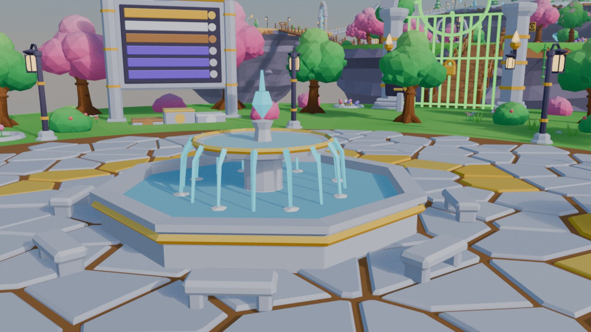
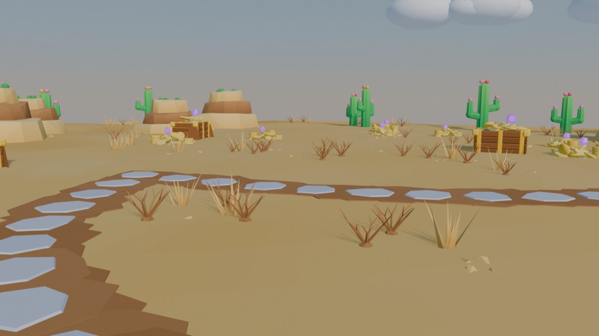
