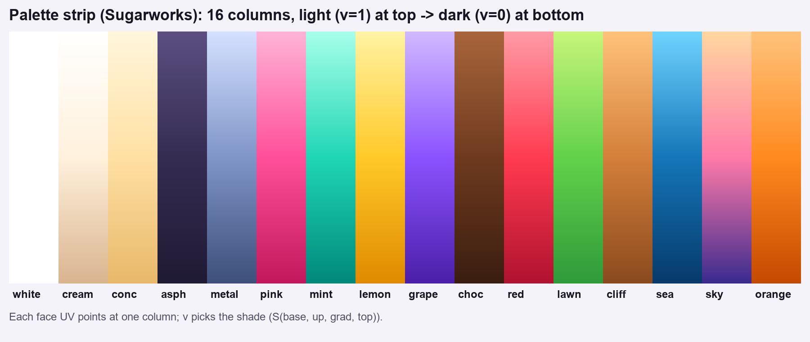
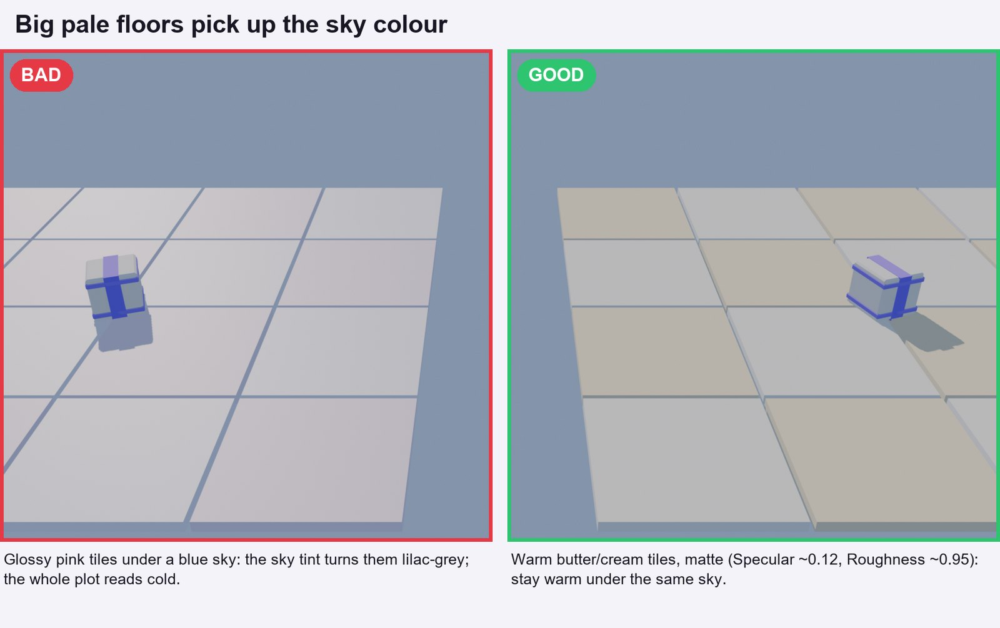
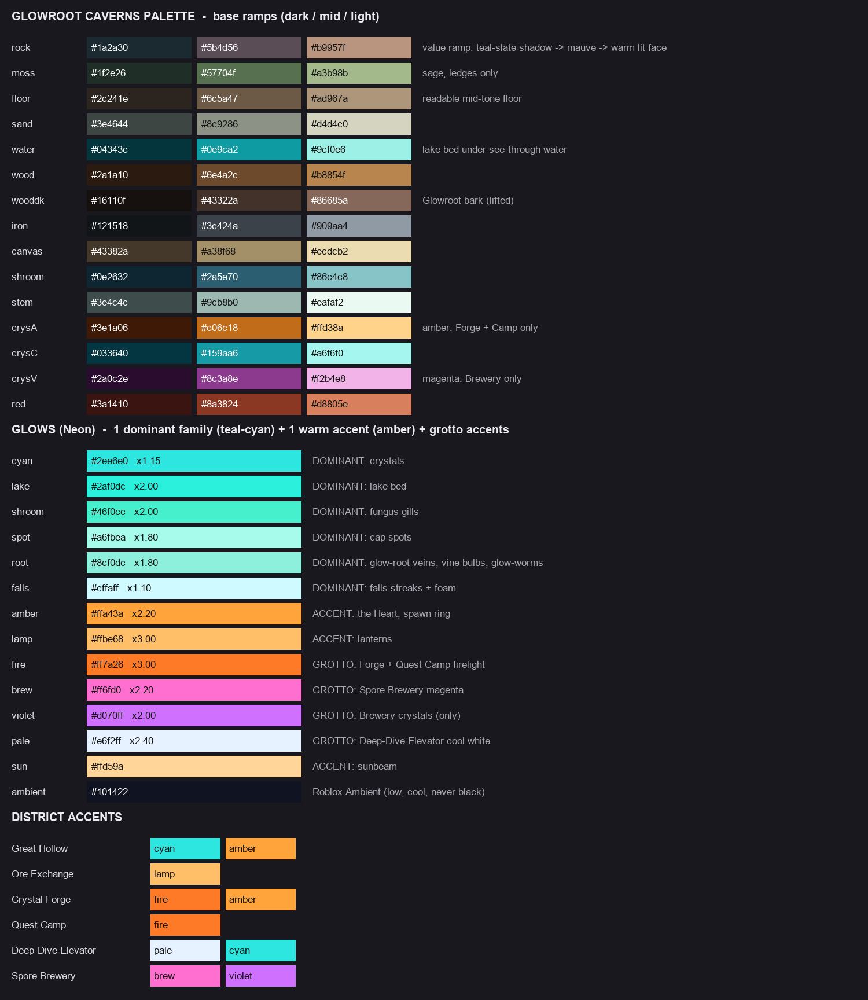

# Palette and look

## The palette strip

One `Palette({name: (dark, mid, light)})` per build (max 15 ramps + white). It becomes a 512 px strip texture; every
face's UV points at one column and its `v` picks the shade. Benefits: flat stylised colour with soft gradients, one
texture for the whole map (Roblox: one download), recolouring a build = editing hex values.

### Building a palette that works
1. Name ramps by MATERIAL, not hue: `cream`, `asph`, `lawn`, `cliff`, `choc`, `sea` - it keeps every surface on theme.
2. 3-5 base ramps (big areas: ground, floors, walls, cliffs) low-to-mid saturation; 2-4 accent ramps (props, trims,
   interactables) high saturation; 1-2 special (sea, sky).
3. Each ramp: dark = shadow side / under, mid = the colour you mean, light = top-lit highlight. Keep the hue steady
   along the ramp (a hue shift toward warm in the light end looks good, toward grey does not).
4. Saturation hierarchy: hero > interactables / rewards > props > ground. Never saturate the ground.
5. Darkest values only on small trim, asphalt, interiors.

### Palettes used so far

| Map | Bases | Accents | Look |
|---|---|---|---|
| Whispering Grove | grass, bark, stone, dirt | crystal violet, lamp amber, door teal | warm noon, light haze |
| Frostpeak | snowfield, slush, stone, wood | berry red, window amber, ice cyan | cold noon, long blue shadows |
| Sugarworks | cream, butter tiles, lawn, caramel cliffs, asphalt | pink, mint, lemon, grape, red, orange | golden-hour sunset, cotton-candy clouds |
| Glowroot Caverns | rock value ramp (teal-slate -> mauve -> warm), sage moss, mid-tone earth | teal-cyan glow family, amber accent, per-grotto fire / cool white / magenta | underground, glow-lit, one warm sunbeam |

### Colour pass lessons (Sugarworks)

- Big pale floors pick up the sky. Pink tiles under a blue sky read lilac: use warm floors (butter, cream, caramel)
  and a matte palette material (Specular IOR Level ~0.12, Roughness ~0.95), world strength ~0.55.
- If the whole render looks grey/mauve, check haze density and world strength before touching the palette.

## Colour palettes (method: do this BEFORE building)

A map reads as designed when its colours obey a plan, not when every prop picks its own glow. Glowroot Caverns'
first pass had near-black navy rock and cyan / violet / amber / lime glows competing everywhere; the fix was this method
(before / after: `examples/cavemap/previews/before_after.jpg`).

1. **Make the swatch sheet first.** Put the palette in a pure-Python module (`examples/cavemap/cave_palette.py`: `BASE`
   ramps, `GLOW` keys with role + strength, `DISTRICT` accents), render it with `palette_sheet.py` to
   `previews/palette.png` (hex on every swatch), paste the table into `BRIEF.md`, and make the props module read it
   (`Palette(CP.BASE)`, `G.GLOW` / `G.GLOW_E` from `CP.GLOW`). Hooks / light colours read the same module.
2. **One dominant glow family + ONE accent.** Pick the family that owns the map (caves: teal-cyan from the water and
   crystals; it also takes fungi, vines, veins) and one warm accent kept for the focal points (amber: the hero, lanterns,
   sunbeam). A third hue only as a district accent. Never sprinkle every hue everywhere (rainbow noise), and recolour
   off-family details (lime vine dots -> soft teal).
3. **Value ramp in the base material.** The big surface ramps carry the light: dark end cool and deep, light end warm
   (rock: teal-slate #1a2a30 -> mauve #5b4d56 -> warm mauve-brown #b9957f), so lit faces read as rock, not void.
   Hue may shift along the ramp (cool shadow -> warm light), saturation stays low.
4. **Value structure.** Floors a readable mid-tone, walls darker, ceilings darkest but rim-toned (convex ribs lifted),
   brightest at the focal points (hero in the beam, the water). Never crush to black: a low cool ambient (#101422) lifts
   everything; in previews add dim fill lights where Roblox Ambient would light.
5. **Per-district accents.** Each station / zone owns one small accent so it is memorable (Forge fire orange, Camp warm
   firelight, Elevator cool white, Brewery magenta), used only there: props, glows and the one station light.
6. **Lights follow the palette.** Few PointLights (~30), each placed where it carries the read (hero, water, station
   accent, a few lanterns, the biggest crystals); every other glow stays Neon only.

## The look (preview lighting in Blender)

| Part | Setting | Notes |
|---|---|---|
| Sky | gradient: TexCoord Generated Z -> MapRange -> ColorRamp | horizon warm/pale, zenith blue/violet |
| Sun | elevation 15-35 deg, warm colour, energy 3.5-5.2 | low sun = long shadows = depth |
| Haze | Principled Volume cube, density 0.00015-0.0007, warm or cool tint | see `bug_haze.png` |
| Colour | AgX + AgX Punchy | keeps saturated accents from clipping |
| Glow | emission, facing-driven strength | hue survives (no white blowout) |

Variety: every map needs a different look (time of day, sky, haze tint, sun colour). Noon, cold noon and sunset are
used; good next ones: overcast teal, night with lanterns, misty dawn, underground (no sky, glow only), neon dusk.

## Matching the look in Roblox

`roblox_export.py` writes the look into `M.Look`; `ApplyLook()` maps it to Lighting (ClockTime chosen so the sun
direction matches), Atmosphere (density, colour, decay, haze), ColorShift_Top, ambient, Bloom and a light colour grade.
Details: `roblox_pipeline.md` section 8. Always compare a Studio screenshot with `previews/map_spawn.png`.

### Haze rule (Mistvale Lake, tested in Studio 2026-11-18)
Roblox Atmosphere Density above ~0.35 washes big maps out (0.6 turned a 400-stud bowl solid blue; 0.3 read well).
Preview haze must match the Studio values (Mistvale: Blender volume density 0.0011 ~ Atmosphere 0.28); heavy preview
haze hides bare geometry: a smooth backing slope behind the cliffs looked fine in a hazy preview and was a huge bare
wall in Studio. Check renders with the Studio-strength haze, and make terrain behind set dressing stop just behind it.
`roblox_export.py` now maps the preview density to `min(0.32, 0.2 + density x 60)`.
