# Prop cookbook: how the kit props are built

All props are plain Python functions returning a `Prop` (solid mesh + glow meshes by key), built in Roblox space at
y = 0 with front = -Z. Primitives come from `scripts/pro_lib.py`; helpers from `examples/whispering_grove/forest_props.py`.
QA every prop on a kit sheet (`scripts/kit_sheet_template.py`) before it goes in a map.

## Kit sheets of the three examples

Grove (forest RNG quest map): trees, ferns, mushrooms, rocks, camp, quest board, elder tree.

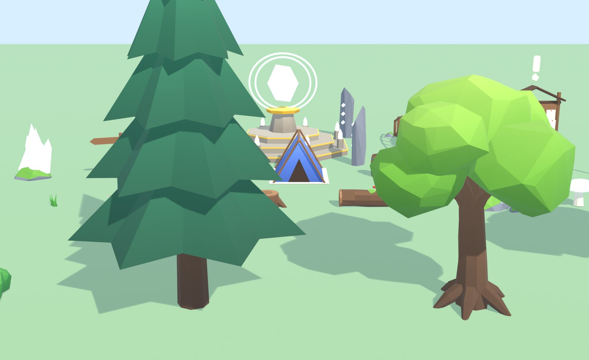
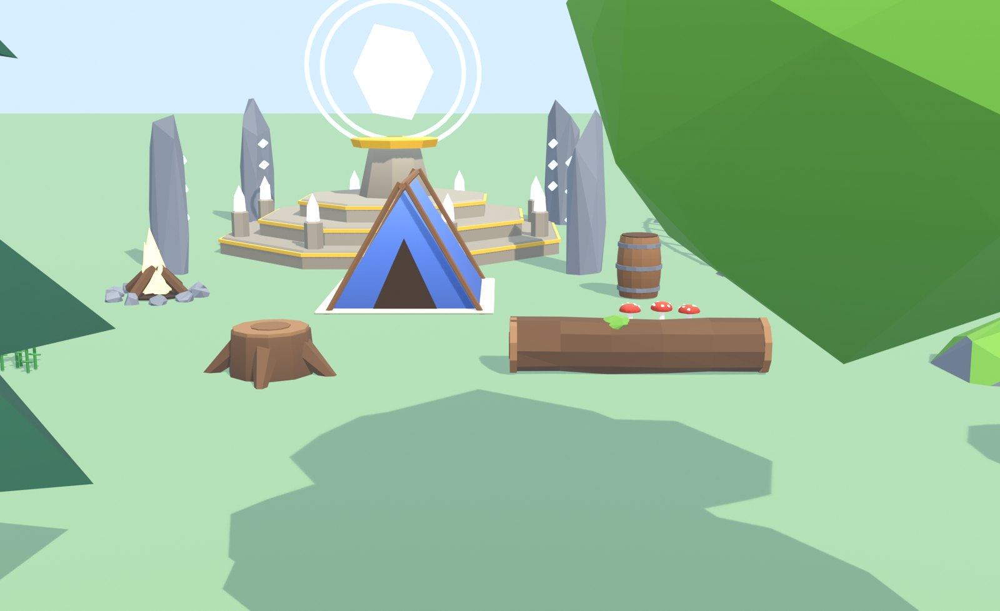

Frostpeak (village): log cabins with plank doors, shutters, chimneys and woodpiles; fishing huts; well; stalls; spire.

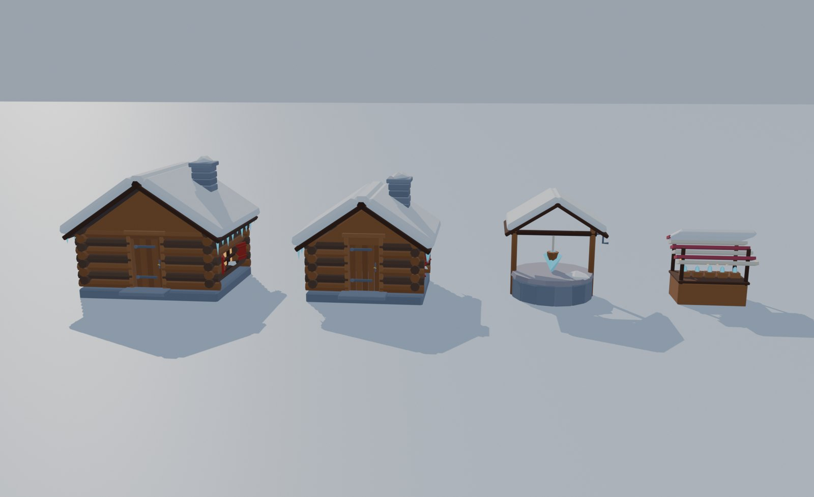
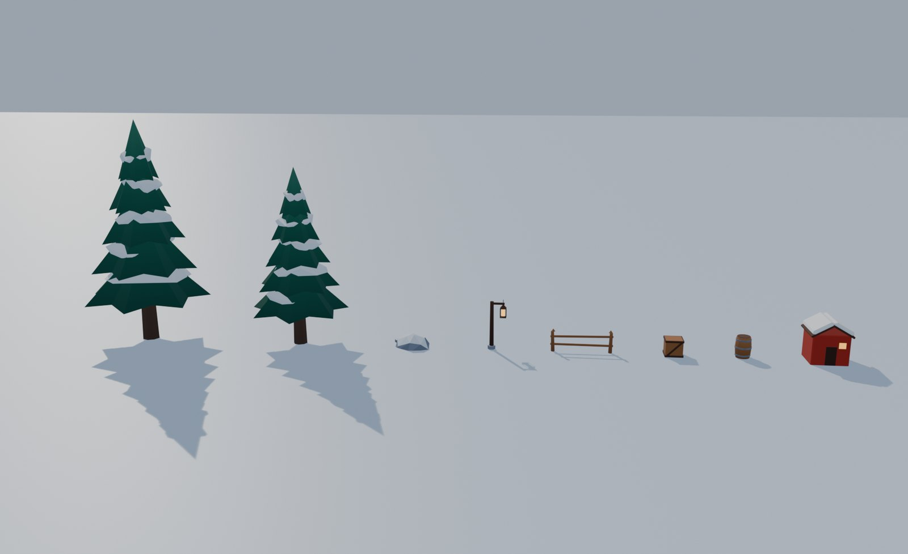

Sugarworks (tycoon): Candy Exchange (hero), gate + team glow, dropper, conveyor with candies, upgrader, collector,
cash pad, buy button, slot markers, lollipop trees, gumdrops, candy-cane lamp, chocolate fountain, coin chute.

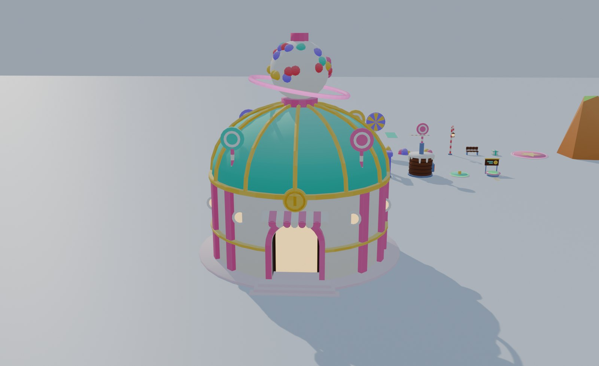
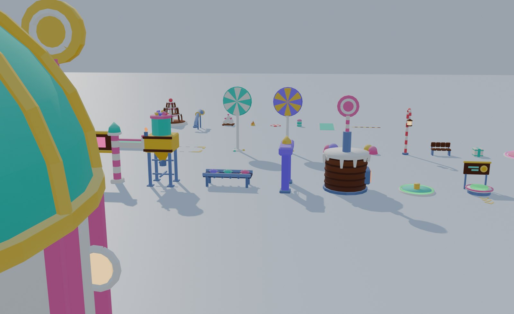
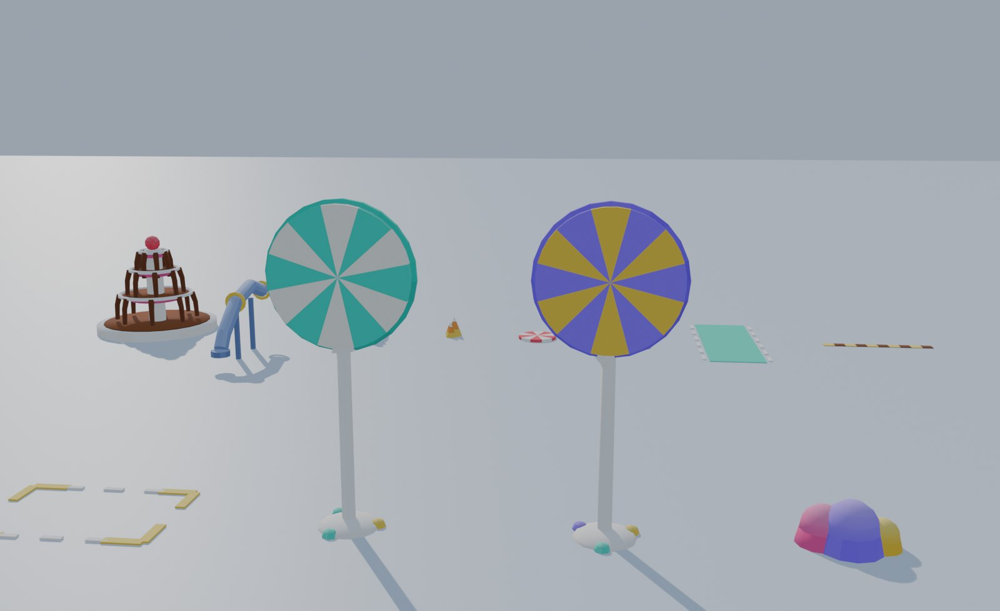

Skyrise (zone simulator): Trophy (hero), egg shrine, zone gate with glow bars, sell pad, upgrade stand, teleport
pad, leaderboard, resource nodes (coin pile, chest, crystal node), biome dressing (puffy trees, cacti, mesas, ice
spikes, snow trees, basalt, lava pools / cracks), bridges, floating rocks, clouds.

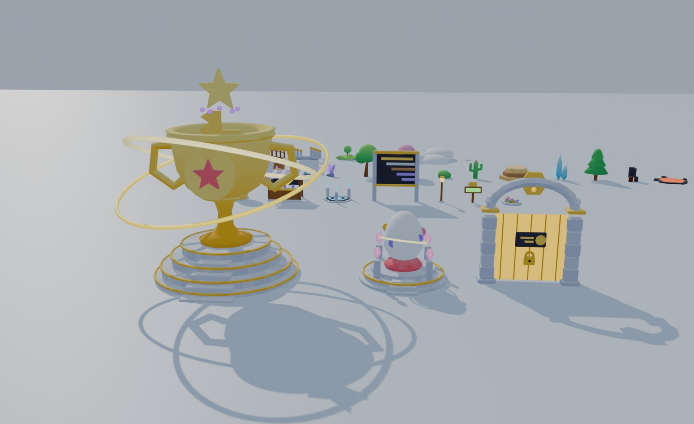
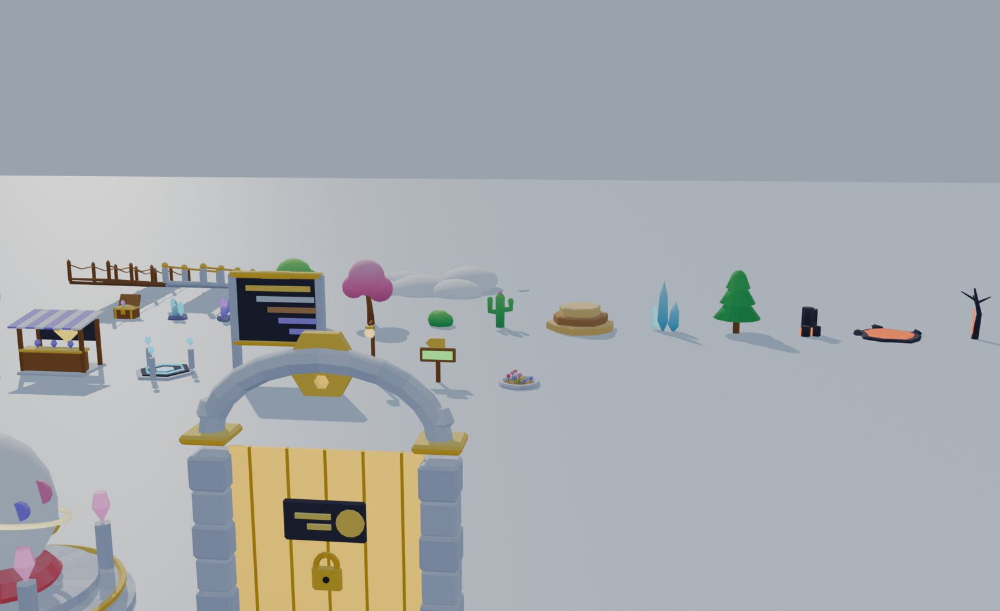

Moon Sweepers (clean-the-moon sim, `examples/moonclean/moon_props.py`): one theme (retro space programme: white
panels, gold foil, orange chevrons, rivets, port windows), one signature edge (`beacon_post` / `beacon_rail`: runway
beacon posts with amber caps on every lip, pad and gate), one shared station base (`station_base`: hex pad on four
splayed lander legs, chevron rim). Stations: Dust Exchange (open hopper + ribbed hose + glowing canisters), Gear
Locker, Re-Entry Pod (capsule + orbit ring), Egg Incubator (cages); hero rocket + launch tower; lunar lander; airlock
gate; jump pad; mess props (dust patch / pile, junk heap, meteor chunk, ice shards) sized ~1.5x so they read from 30
studs. Helpers worth copying: `lathe`, `dish` (parabolic, with thickness), `egg`, `ShAng` (two-colour checker by face
angle: rocket roll pattern), `port` (framed round window), ribbed hose = tube + tori along it.

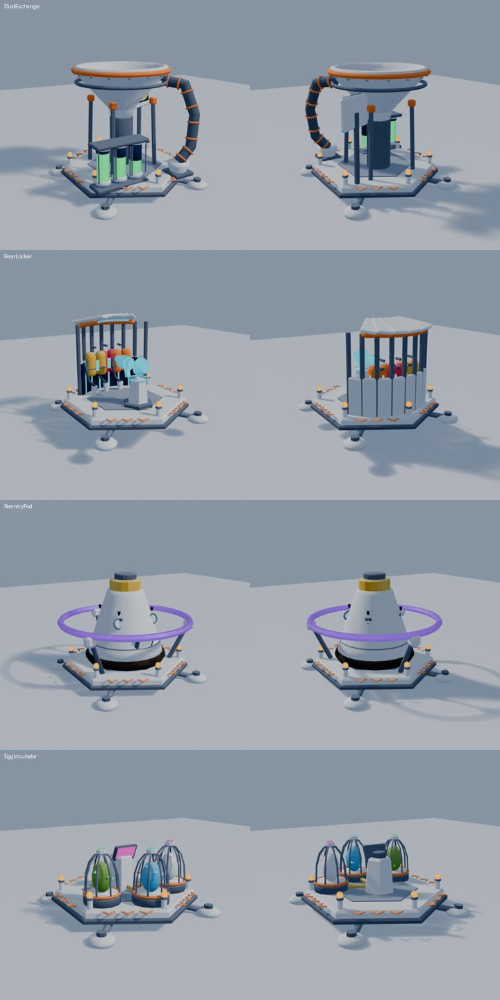
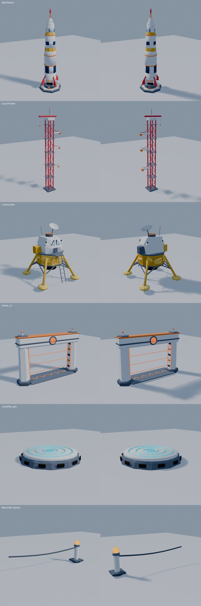
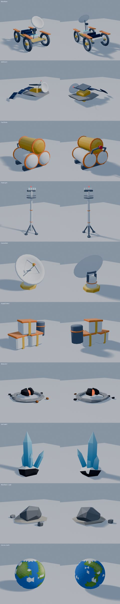

## Primitives (pro_lib + example helpers)

| Function | Shape | Typical use |
|---|---|---|
| `box(size, bev)` | bevelled box | planks, slabs, crates, walls, boards |
| `cyl(r, h, sides, r2, y0)` | (tapered) cylinder from y0 up | posts, drums, pads, buttons, bowls (`r2`) |
| `spike(r, h, sides, shoulder)` | cone with a shoulder | roofs, gumdrop tops, funnels, carrots, shards |
| `tube(pts, radii, sides)` | swept tube along points | trunks, branches, pipes, chutes, rails, ribs, candy canes |
| `hull(pts)` / `rock(r)` / `blob(r, seed)` | convex hull | rocks, canopies, sacks, clouds |
| `ngon_prism(poly, y0, y1)` | extruded polygon | gables (pitch -90 about X), stars, wedges, chevrons |
| `dome(r, h)`, `sphere(r)`, `torus(R, r)` | Sugarworks helpers | domes, gumballs, rings, rims |
| `lathe([(r, y), ...], n)` | Skyrise helper: revolve a profile | trophies, cups, eggs, pedestals, pads, crystals, gems |
| `gem(r, h)` | 6-sided lathe gem | glow gems on gates, pillars, chests |
| `arch_frame / arch_prism / arch_tunnel / arch_cap` | arch pieces | real doorways (see below) |
| `bool_diff(a, b)` | exact boolean A - B | doors, windows, hollow shells |
| `voronoi_cells` + `shrink` | paving cells | plazas, squares, crazy paving |

Shading: `S(col, base, up, jit, grad=(y0, y1, a, b), top='snow', thr, topbase)`. `base` picks the shade in the column,
`up` lightens up-facing faces, `grad` paints a height gradient (dark at the foot, light on top), `top` caps up-facing
faces with another colour (snow, moss, grass).

## Recipes

### Doorway that is really a doorway
1. Hollow the host first: `wall = bool_diff(cyl(R, h), cyl(R - t, h + 2))` (a solid host leaves a flat wall in the hole).
2. Cut: `bool_diff(wall, arch_prism(hw, spring, z_front - 4, z_front + 4))`.
3. Frame: `arch_frame(hw, spring, t, ...)` slightly proud of the wall.
4. Depth: `arch_tunnel` (dark) and an `arch_cap` at the back; put a glow cap just in front of it for a lit interior.
5. Anything that wraps the host (trim bands, rings) must be hollow and cut too, or it bars the door.

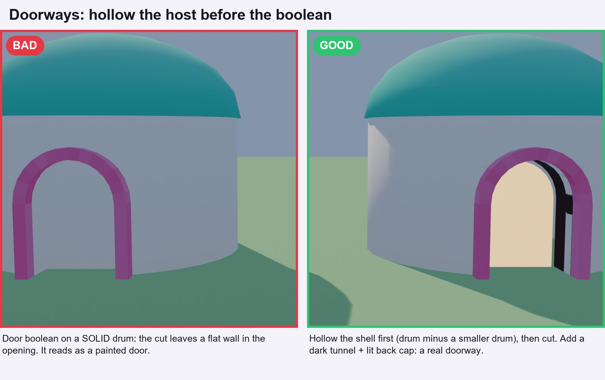

### Buildings that read as built, not boxes
- Walls from courses or boards (alternate two shades), corner trims, framed door with straps + handle, windows with a
  frame, mullion, sill and shutters, a chimney of stone courses from the wall top up through the roof.
- Pitched roofs: two slabs + ridge beam + ridge cap (no V-gap), snow/moss caps via `top=`, overhang 0.6-1.0.
- Side extras sell scale: woodpile under a lean-to, door-side crate/barrel/lantern (lantern on the other side of the
  door, 1+ stud gaps), stovepipes, gutters.

### Machines (tycoon)
- Read the function from the silhouette: hopper on legs = dropper, rails + rollers = conveyor, arch with a ring =
  upgrader, vat with a glowing mouth = collector, pad with coins = cash pad.
- Parts must clear each other where things move: legs outside belt rails, ring radius < pillar offset, scan beams
  thin over the belt, chute ends above the pad.
- Show flow: candies on the belt, chevrons pointing at buttons, a pipe from collector to cash pad, hazard stripes.

### Techniques that lifted the Skyrise kit (see `examples/skyrise/sky_models*.py`)

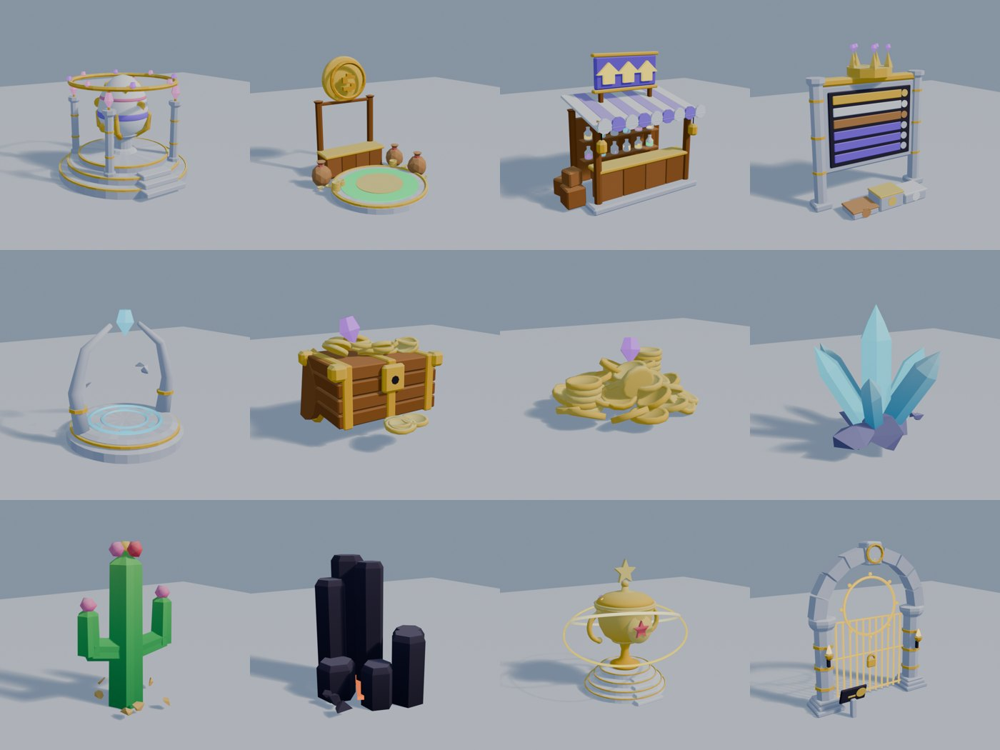
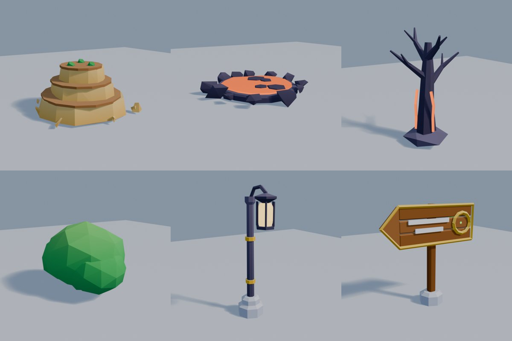

| Technique | Code | Used for |
|---|---|---|
| Lumpy faceted clumps | `lumpy(r, seed, sub=2, amp=.12)` = noise-displaced icosphere | tree canopies, bushes, sacks, rock lumps |
| Lathe profiles | `lathe([(r, y), ...])` with collars, lips, bevel steps | pillars, pedestals, bottles, eggs, coins, lantern cages, columns |
| Star-section sweep | `_ribbed(a, b, r0, r1)` + sphere elbow joints | cacti, ribbed columns |
| Separate planks | `planks(w, h, d)` alternating shades | counters, walls, crates, chests, signs |
| Voussoir arch | one convex hull per arch stone + keystone | gates, doorways, bridges |
| Coins from coins | `coin()` lathe stacked / tilted in rings | coin piles, chests, sell booth |
| Curved lid on a hinge | half-cylinder rotated about the back edge + bands following it | chests |
| Grass skirt | continuous jagged band (2 layers) under the island lip | floating islands, cliff tops |
| Tapered underside | rings to 16% radius + noise + ledges + pushed-out boulders + broken tip chunks | floating islands |

### Stud / Parts props (`scripts/blocks.py`, `examples/plusspeed/`)

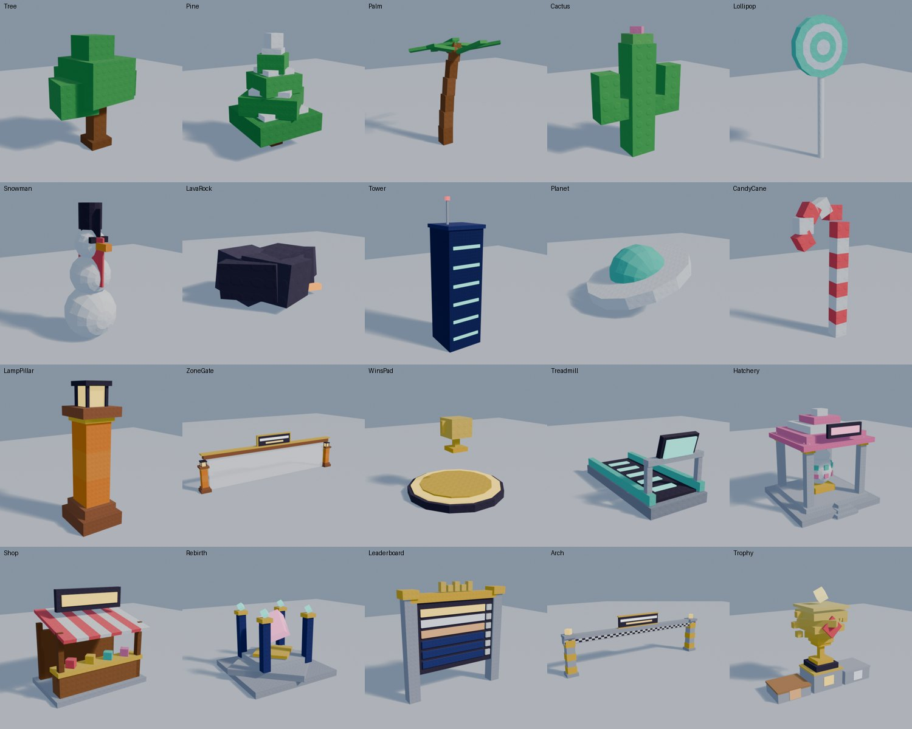
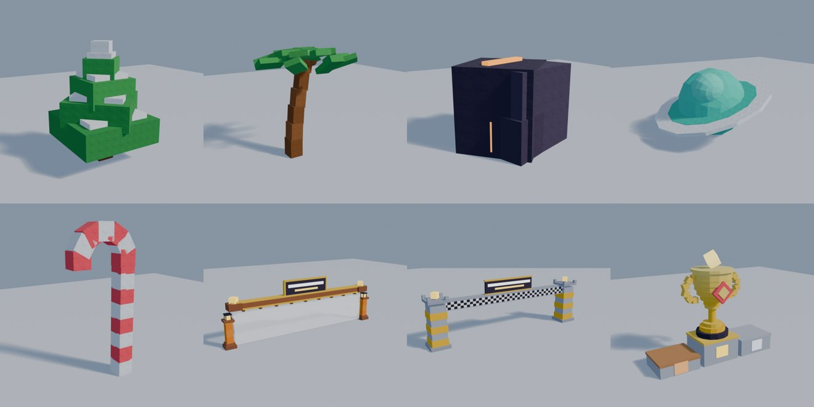
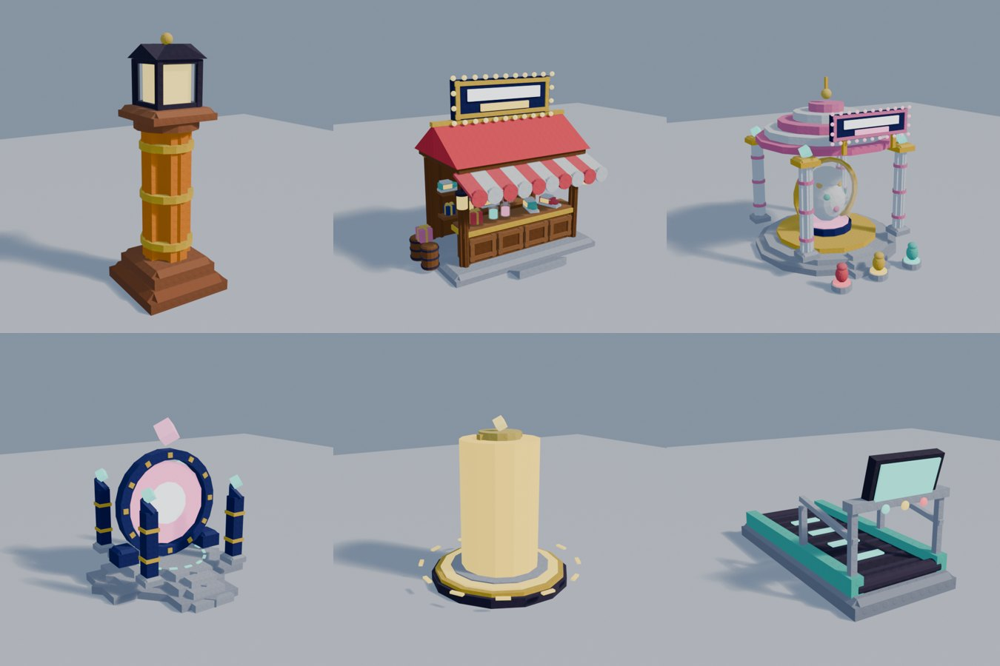

v3 (after "super weak models"): lamp = chamfered stepped plinth + 8-sided banded column + caged glowing lantern + wedge
roof; shop = panelled counter, shelves of shoes / potions / gifts, gable roof, scalloped awning, marquee sign with
bulbs, hanging lanterns, barrels; hatchery = tiered round base, glass dome over a spotted egg, ring frame, ornate
pillars, stepped round roof, display eggs; rebirth = round dais with rims, rune ring, tangent-block portal ring with a
glowing disc, obelisks; wins pad = rimmed stepped disc, glow ring, light column, cylinder trophy.

- Build from chunky blocks with 2-3 shades of one ramp; stack and offset cubes for trees, pines (square tiers rotated
  45 deg every other tier, tiers touching), cacti (column + elbow arms), palms (tilted segments + two-segment drooping
  leaf slabs), towers (block + neon window strips), trophies (stacked cylinders + block handles on an arc).
- Cylinder Parts run along X: rotate (0, 0, 90) for upright posts / flat discs, (0, 90, 0) for discs facing front.
- Neon only for lanterns, pads, lines, windows, seams; everything else stud Glacier.
- Big spans (gates, arches) need chunky ends: thicker towers, beam ends, battlements - a thin beam between thin posts
  reads as a fence.

### Floating island (sky maps)
- Top: polar grid on a wobbly rim, flat middle, gentle bumps outward; a 0.6 dirt lip down the edge.
- Underside: rings shrinking to a tip (`t^1.6`), colour bands by depth (strata), hanging rock spikes, roots, vines with
  leaf balls, and 2-3 clusters of glow crystals breaking out of the rock (big enough to read: 6-12 studs).
- Sell height: a few small floating rocks (grass cap + rock cone, some with a tree) between islands.

### Simulator stations
- Each station = a silhouette you can read from 60 studs: egg on a cushion on a round podium; sell pad = glowing disc
  + giant coin on a stand; upgrade = booth with an up-arrow sign (check arrow rotation: (-90, 0, 0) points it up);
  leaderboard = framed dark board with coloured rank bars + crown; teleport = hex pad with three gem posts.
- Zone gates: banded stone pillars + arch + crest gem, a price plate and padlock on the approach side, and the barrier
  as **glowing bars you can see through**. A solid glowing panel reads as a wooden door.
- Resource nodes: clusters of 3-5 (coin piles with coins standing up, open chests with a glow gem, crystal clusters
  in the biome colour). Bright gold (base >= .7) or they read as dirt heaps under a blue sky.

### Trees and plants (stylised)
- Trunk = `tube` with taper and root flares that go below y = 0; canopy = several faceted `blob`s with a height
  gradient (dark under, light on top). Pines = stacked star-cone tiers.
- Candy trees (lollipops): stick + wedge disc (alternating colour wedges) + rim torus + a sugar mound at the foot.
- Bushes and gumdrops = clusters of 3-5 shapes in 2-3 colours of one family, never a single blob.

### Glow
- Separate meshes, key in `GLOW` (hex) + `GLOW_E` (strength). In previews: hex linearised (x^2.2), base 0.45x,
  emission driven by Layer Weight facing. In Roblox: Neon + `M.Glow[key]` colour, PointLight for lamp-like keys.
- Keep glow small and meaningful (lamps, windows, pads, rings, team strips). Big glowing areas wash out under bloom.

### Ground details that make it feel made
- Plaza/apron: voronoi paving cells on a darker base disc (gaps never show grass).
- Paths/roads: kerbs, lane dashes, tiled sidewalks; dirt paths: darker rims, trodden lighter grass along them.
- Lawns: mowed stripes (alternate shade bands), clumped dressing, stepping stones, small story groups.

## Prop checklist (before a prop enters a map)
- [ ] Origin bottom centre (buildings: pivot on the footprint, door +Z), front -Z, built at y = 0.
- [ ] Anything that touches the ground extends below 0 (posts -0.3, trunks/roots deeper).
- [ ] Every opening is cut, not painted; nothing floats or clips through another part.
- [ ] Silhouette reads at 60 studs; detail reads at 15 studs.
- [ ] <= 20k tris per mesh (heroes 7-13k, props 150-1,300 in the examples).
- [ ] Colours from the palette only; one accent family per prop.

### Ground micro-detail (Skyrise detail pass, `examples/skyrise/sky_models4.py`)

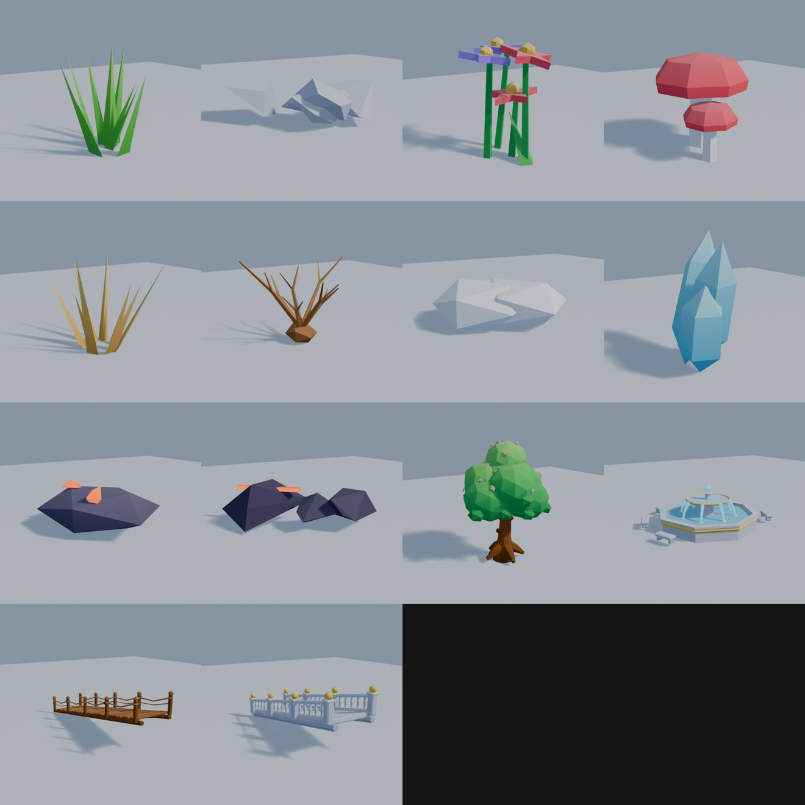
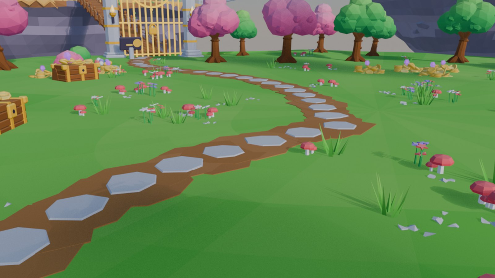

- One small kit per biome, each prop 30-350 tris: meadow = modelled grass tufts (4-tri blade wedges, dark root to light
  tip), wildflowers (stems + 5-point star heads), toadstools, pebbles; dune = dry grass + twiggy shrubs + sand pebbles;
  frost = snow mounds + ice shards; ember = ash piles with glowing embers + ember rocks.
- Scatter in clumps of 3-6 (`micro_detail()` in `sky_map.py`), never singles; keep them 3+ studs off paths, off bridge
  heads and plazas, reserve only a tiny radius so they can sit between bigger props. 30-46 clumps per island.
- Trodden paths: overlapping irregular flat blobs under the stepping stones (`path_track()`), NOT ground-face colouring
  (faces are 4-8 studs wide, so face dirt comes out stair-stepped).
- Ground two-tone patches: shade noise on the top mesh (darker / lighter patches) breaks up big flat colour.
- Blossom trees: 5-point star flowers rotated onto the clump normal, 4 per clump, big enough to read at 30 studs.
- Bridges v2: irregular plank widths + nail heads, X braces under the deck, rope wraps at posts, small lanterns on every
  other post; stone version with balusters under a top rail and gold ball caps.
- A low centrepiece (fountain under ~6 studs) fills an empty plaza without blocking the spawn vista.
