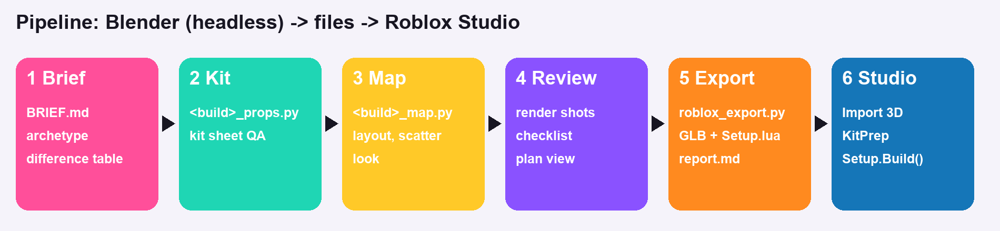
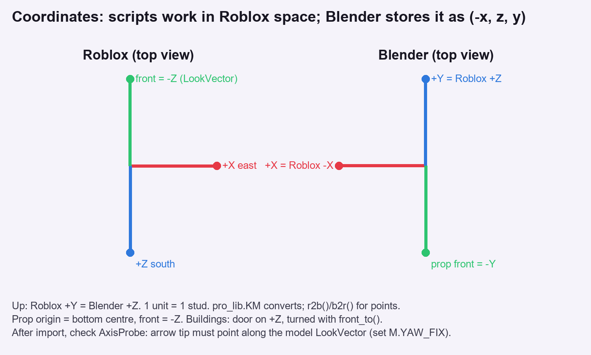
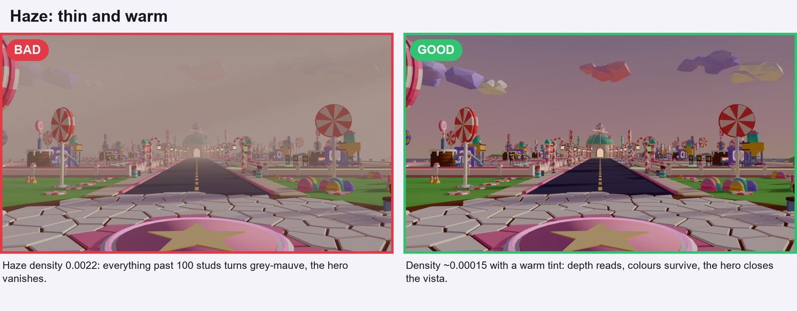
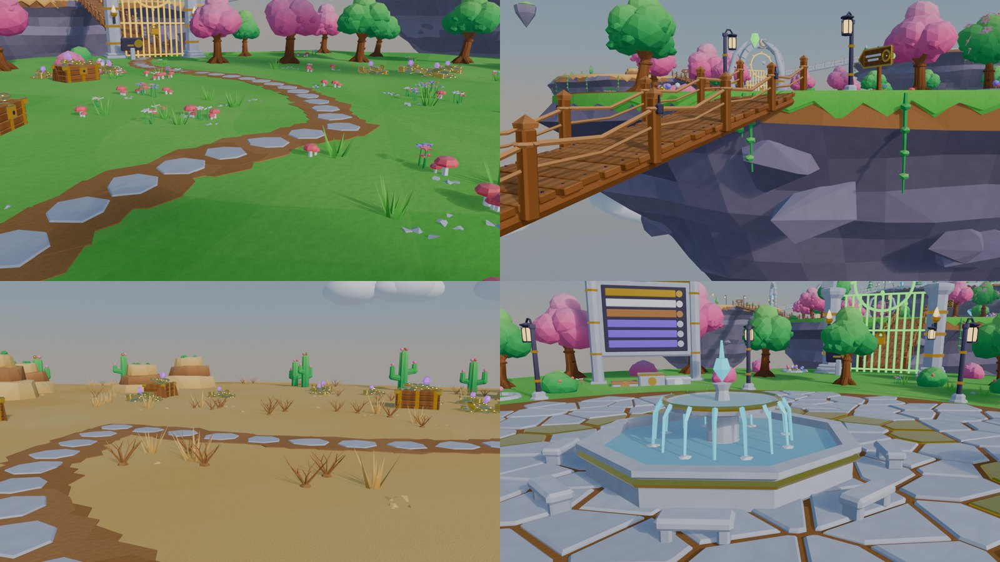

# Roblox pipeline: from the Blender map to a placed, lit map in Studio



The map scripts never touch Roblox. `scripts/roblox_export.py` turns the saved map into files Studio can import plus a
generated Luau module that places everything. Worked output: `examples/sugarworks/roblox_sample/` (Setup.lua,
KitPrep.lua, report.md, manifest.json for a 648-prop map).

## 1. Rules the build scripts already follow (keep them)

| Rule | Why it matters in Roblox |
|---|---|
| 1 unit = 1 stud, Y up, front = -Z (Roblox space in every script) | Imports at the right size; `LookVector` = prop front |
| Prop origin = bottom centre (buildings: pivot on the footprint, door on +Z then turned) | `Model:PivotTo()` drops the prop exactly on its placement |
| One solid mesh + one mesh per glow key | One MeshPart per material slot; glow parts become Neon, never collide |
| Colour = one palette strip (512 px) via UVs | One texture shared by every MeshPart = one download, tiny memory |
| No alpha cards, no photo textures, no n-gons after export (triangulated) | Roblox meshes are triangles; alpha sorting is unreliable on phones |
| Geometry that meets the ground extends below the origin | Uneven terrain never shows a floating base edge |



## 2. Hard limits (checked by the exporter, see `report.md`)

| Limit | Value | What the exporter does |
|---|---|---|
| Triangles per MeshPart | 20,000 | kit props: warns; static ground/hardscape/horizon: split at 18,000 |
| MeshPart size per axis | 2,048 studs | static meshes split at 2,000; low-poly oversize planes (sea) become tiled Parts |
| Part size per axis | 2,048 studs | big parts tiled under 2,000 |
| Texture size | 1,024 px | palette is 512 px; warns if bigger |
| UVs | 0..1 | palette strips must stay in range; warns otherwise |
| Degenerate faces | none | boolean leftovers dissolved on the export copy |

Budgets (phone-first, not hard limits): ~300-600k visible triangles, a few thousand parts in view, < ~100 unique kit
meshes per map. Sugarworks: 62 kit props, 648 placements (955 MeshParts), 345k placed triangles including the horizon.

## 3. Export

```bash
"${BLENDER:-blender}" -b sugar_map.blend --python <skill>/scripts/roblox_export.py -- --name Sugarworks
```

Options: `--out <dir>` (default `roblox/` next to the .blend), `--fmt fbx` (default glb).

Output:

| File | Content |
|---|---|
| `kit/<Prop>.glb` | one prop: `<Prop>` (palette MeshPart) + `<Prop>_Glow_<key>` (Neon later), origin = pivot |
| `static/<Name>_<k>.glb` | ground / hardscape / cliffs / horizon chunks, origin = chunk centre |
| `AxisProbe.glb` | orientation test: arrow along -Z (front), cube on +X, cube on +Y |
| `<Name>_Palette.png` | the shared palette (upload only if the importer drops the embedded texture) |
| `<Name>Setup.lua` | ModuleScript: placement rows, `Build()`, `ApplyLook()`, collision + glow rules |
| `<Name>KitPrep.lua` | command-bar script: per-prop CollisionFidelity, RenderFidelity Automatic |
| `manifest.json` | per prop: parts, tris, size, collision, glow colours; static chunks; big parts; look |
| `report.md` | limits, budgets, per-prop collision, warnings, next steps |

How placements are recovered: every placed object in the `Map` collection shares mesh data with a `Kit` object, so the
exporter groups parts by prop and identical world matrix, then converts the Blender matrix back to a Roblox CFrame
(`R_roblox = KM^-1 R_blender KM`, `p = KM^-1 t`) and stores uniform scale separately (`Model:ScaleTo`). Group = the
object's collection (Plot1..8, Lawn, Street, Hero ...), which becomes a Folder in Studio.

## 4. Import into Studio (manual)

1. **File > Import 3D**, select every file in `kit/` and `static/` plus `AxisProbe.glb` (multi-select works).
   - Scale unit / file dimensions: **studs** (the files are authored 1 unit = 1 stud).
   - Import as Model, **set pivot to scene origin**, anchored, keep materials (the palette texture is embedded).
   - Insert into **ServerStorage**, then put all imported models in one Folder named `<Name>Kit`.
2. Insert `<Name>Setup.lua` as a ModuleScript `ServerStorage.<Name>Setup`.
3. Run `<Name>KitPrep.lua` once in the command bar (Edit mode).
4. Orientation check (below), set `M.YAW_FIX`.
5. Command bar: `require(game.ServerStorage.<Name>Setup).Build(game.ServerStorage.<Name>Kit, workspace)`
6. Optional: `require(game.ServerStorage.<Name>Setup).ApplyLook()`

Alternative upload path: the Blender "Upload to Roblox" add-on (log in inside an interactive Blender session; never
from a headless run). Studio-tested steps: section 12. Never invent asset ids; only use ids the upload returned.

## 5. Orientation check (AxisProbe)

Drag `AxisProbe` into Workspace. Its arrow is the prop front. Compare with the model's pivot `LookVector`:
- arrow tip points along `LookVector`, red cube on the model's right (+X): `M.YAW_FIX = 0`
- arrow points backwards: `M.YAW_FIX = 180`

The setup module applies `CFrame.Angles(0, rad(YAW_FIX), 0)` to every placement (rotation about the prop's own pivot),
so one constant fixes the whole map. Do this once per importer version / file format.

## 6. What `Build()` does (generated, idempotent)

- Destroys the previous root only if it carries this map's CollectionService tag, then builds `workspace.<Name>`
  (Model) with one Folder per group.
- Clones each kit Model, `ScaleTo` (if scaled), `PivotTo(row CFrame * YAW_FIX)`.
- Every BasePart: Anchored (also a kit file imported as a single MeshPart), CanTouch off. At the end `Build()` walks the
  whole root once more, anchors anything still loose and warns with the count (`N parts were not anchored`). Glow parts (`*_Glow_<key>`): Neon, `M.Glow[key]` colour, CanCollide /
  CanQuery / CastShadow off, plus a small PointLight (range 8, brightness 0.6, no shadows) for `M.LightKeys`
  (lamp, furnace, window, fire). Solid parts: collision from `M.Collision[prop]`; parts under 2 studs cast no shadow.
- Oversize planes (sea) become tiled SmoothPlastic Parts with the palette colour sampled under them.
- Warns once per prop missing from the kit folder.

Verified in Studio (2026-11-17) with a stand-in kit: compiles, second run replaces the first (one root), rotation and
`ScaleTo` match the Blender placement, glow parts get Neon + PointLight, sea tiles build.

### Flowing water (`M.AnimateWater`)
Parts whose name contains `river`, `stream` or `falls` (any case; static chunks keep the map script's object name, so
name the stream static `Stream_Water`, not part of `Lake_Water`) get a scrolling Texture: `Top` face for rivers and
streams, `Front` + `Back` for falls, `OffsetStudsV` advanced every frame at `M.WaterFlow` studs per second (river 6,
stream 6, falls 14). Set `M.WaterTexture` to a tiling streak texture YOU uploaded (never an invented id); with it empty,
only Textures already parented to those parts scroll. It runs on the client: put a copy of the setup module in
ReplicatedStorage and add a LocalScript in StarterPlayerScripts:
```lua
local Setup = require(game.ReplicatedStorage:WaitForChild("<Name>Setup"))
Setup.WaterTexture = "rbxassetid://<your uploaded streak texture>"
Setup.AnimateWater(workspace:WaitForChild("<Name>"))
```
Still water (lakes, pools, the sea) is left alone.

## 7. Collision

| Kind | Fidelity | Use for | Examples |
|---|---|---|---|
| none | Box, CanCollide off | things you walk through or over | hazard paint, walkways, slot markers, flowers, grass, clouds |
| box | Box | roughly boxy props | crates, benches, buttons, fences, plot slabs, lamps |
| hull | Hull | convex-ish props | rocks, bushes, trees, machines |
| precise | PreciseConvexDecomposition | walkable / enterable shapes | ground, hardscape, cliffs, buildings with doorways, gates, bridges |

Built-in rules live in `COLLISION` at the top of `roblox_export.py` (regex on the prop name, case-sensitive, first match
wins). A map's own rules go in `collision_rules.json` next to its .blend (`{"rules": [[regex, kind], ...]}`), loaded first
(or pass `--collision <file>`), so the shipped exporter never needs per-map edits.
`KitPrep` sets `CollisionFidelity` directly; where Studio refuses (already-loaded MeshPart) it re-creates the mesh with
`AssetService:CreateMeshPartAsync(meshId, {CollisionFidelity, RenderFidelity})` and `ApplyMesh`. For a few very large
precise meshes (the Exchange, ground chunks) a set of invisible Box parts is often cheaper; add them by hand if the
MicroProfiler shows physics cost.

## 7b. Placement checks (hard: any failure = `OVER_BUDGET placement:` lines, `EXPORT_FAILED`, exit 1)

Run on every export, against a BVH of every static chunk and every non-foliage placed prop (each face knows its
owner, so a prop never collides with itself). The log prints `CHECK_COUNTS {...}`; `report.md` repeats the counts.

| Check | Fails when | Fix in the map script |
|---|---|---|
| clip (props) | > 5% of a non-rock, non-water prop's body (vertices above its lowest 15%) is inside a rock, cliff, static chunk or another prop. Inside = at least 5 of 6 axis rays first hit a back face, so closed volumes count and open sheets (ground) do not | move it, or move the rock; pass the real footprint to the rock / cliff placer |
| clip (foliage) | > 8% of a foliage prop (`--soft`) inside a solid | place foliage last against the built geometry |
| float (props) | the lowest point is > 0.5 above the highest surface found by rays down from the footprint centre and 4 inset corners (anything solid or water, not the prop itself); nothing below = floats | ground it on the lowest corner |
| float (foliage) | lowest point > 1.0 above the hit under its origin | as above |
| water bed | > 2% of up-facing points of a `--water` object (water, lake, river, stream, pond, pool, falls, moat) have no solid within 8 studs below, unless a bank covers them from above | a bed mesh under the whole surface (a 2-tri seabed for a sea plane) |
| water bank | > 2% of its edge points stand above the bank (the surface at that spot is lower than the water) and touch neither a wall within 0.6 nor other water | widen the bed / channel so the edges run under the banks, or lower the water to the bank |
| falls | waterfall props (`falls`, `waterfall`, `cascade`): fewer than half of the top points within 2.5 of rock / ground (the lip), or of the foot points within 3 of other water (the pool) | seat the lip on the cliff, give it a pool |
| collision | foliage with collision; a rock > 4 studs with `none`; a walk-through prop (`--walk`: bridge, stair, dock, arch, gate, door, house, hall, shop, stall ...) with `hull`; water with `hull` / `box` (or a precise static water plane); a walkable static with `hull`, or with `none` and no colliding floor within 1.5 studs below; a path (`--path`) blocked from 0.3 to 5 studs above by a colliding prop (2+ hits) | fix the `COLLISION` rule or move the prop |
| buffer (`--cliff-buffer N`, default 0 = off) | a building / stall / prop over 6 studs, or a tree trunk base, or a path point, within N studs of a cliff (rocks or statics matching `--cliff`, 10+ studs tall) rising 2+ studs above its base | fit the cliff foot round the village (the Mistvale `FOOT_NEED` pattern), or move the prop |

Rocks (`--rock`: rock, cliff, boulder, stone, crag, mesa, butte, stalag) may overlap rocks and be bedded into the
ground by design, so they are never clip-checked; they are still float-checked and are obstacles for everything else.
Props that hang or hover on purpose are exempt from float (`--float-ok`: hang, vine, ivy, rope, cloud, bird, lily,
canopy, `_leaves`, `_branches`, glow, beam, debris, orbit). Statics the player cannot reach are exempt from the
walkable-floor rule (`--no-walk`: horizon, sky, backdrop, far, distant, cloud, skirt, backwall, mountain). Override
any regex on the command line; never use `--no-clip-check` to ship.

## 8. Lighting (`ApplyLook()`)



The exporter reads the Blender look and writes `M.Look`:

| Blender | Roblox |
|---|---|
| sun direction | `ClockTime` = 6 + elevation/15 (east) or 18 - elevation/15 (west); `ApplyLook` tries both and keeps the one whose `Lighting:GetSunDirection()` matches the Blender sun best, warns if the match is poor (then tune `GeographicLatitude`) |
| sun colour / energy | `ColorShift_Top`, `Brightness` (energy / 1.4, capped 5) |
| haze volume density / colour | `Atmosphere.Density` = min(0.32, 0.2 + density x 60) (above ~0.35 big maps wash out, see palette_and_look.md), `Atmosphere.Color`, `Haze = 1` |
| sky horizon / zenith | `Atmosphere.Decay` (horizon), `Ambient` / `OutdoorAmbient` from the zenith |
| AgX Punchy | `BloomEffect` 0.35 / 16 / 1.05 and a light `ColorCorrectionEffect` (contrast / saturation 0.12, sun tint 12%) |

Set `Lighting.Technology = Future` (Studio Properties) for PointLights on glow parts. Compare a Studio screenshot with
`previews/map_spawn.png`; adjust `M.Look` numbers, not the build.

## 9. Streaming and performance

- Big maps: enable StreamingEnabled; each placed prop is its own Model, so it streams as a unit. Plots and other
  gameplay areas should be Models (they are Folders under the root; convert to Models with `ModelStreamingMode =
  Atomic` if a plot must arrive whole).
- Every kit prop is one shared mesh asset: 8 plots of the same machines cost the memory of one.
- RenderFidelity Automatic (KitPrep) lets Roblox drop detail at distance.
- Cut before import if `report.md` is over budget: fewer rim trees, simpler far trees, merge tiny dressing into
  bigger props, drop the horizon (use a Roblox Sky + Atmosphere instead).

## 10. Re-exports

Re-run the map script, then the exporter. Re-import only the changed `kit/` files (Studio replaces by name if you
delete the old Model first), replace the ModuleScript source, run `Build()` again. The tag check means it never
deletes anything it did not make.

## Known gaps

- Roblox Terrain is not generated; ground is mesh. For a terrain-based game, sample `H(x, z)` into
  `Terrain:WriteVoxels` instead of exporting `Ground_*` (keep paths and plazas as meshes).
- Text on signs is not modelled (no fonts in meshes): add SurfaceGui labels in Studio.
- The exporter does not upload. Import in Studio, or use the Blender upload add-on in an interactive session (section 12).

## 11. Roblox materials per object (`--materials`)



Instead of the palette texture, every part gets the Roblox material that fits it (Grass, LeafyGrass, Ground, Rock,
Slate, Sand, Snow, Ice, Basalt, Wood, WoodPlanks, Foil for gold, Marble, SmoothPlastic ...) plus its colour.

```bash
"${BLENDER:-blender}" -b <map>.blend --python <skill>/scripts/roblox_export.py -- --name <Name> --out roblox_mats --materials [--mat-tile 8]
```

- The map script owns the choice: a `MATERIALS` dict (palette ramp -> Enum.Material name) and `MAT_OVERRIDES`
  (`{prefix: 'Mat'}` for a whole prop, `{prefix: {ramp: 'Mat'}}` for some ramps: tree trunks `wood -> Wood` while
  bridges keep `WoodPlanks`, pink canopies `pink -> LeafyGrass`, clouds `SmoothPlastic`). `scripts/roblox_materials.py`
  previews it in Blender (one material slot per Roblox material, procedural bump / roughness / metal per material) and
  writes `material_map.json` next to the .blend; the exporter reads it.
- Export: each solid mesh is split into one MeshPart per (material, quantised colour), <= 8 per prop, with box-projected
  UVs (1 UV = `--mat-tile` studs). The setup module clears TextureID and sets `Material` + `Color` from
  `M.PartMaterial` / `M.PartColor`. Glow parts stay Neon.
- Cost: same triangles, ~4x the MeshParts (Skyrise: 1.7k -> ~7k placed). Check the MicroProfiler on a phone.
- Not yet verified in Studio: material texture scale on MeshParts (tune `--mat-tile`).
- Rule: no stud texture over every model (tried, looked wrong). Do not offer it for mesh maps; block (Part) maps
  are the place for studs (`scripts/blocks.py`).
- Exporter fix that came with this: objects are created with their exact names (`newobj`); before, names that clashed
  with kit objects got a Blender `.001` suffix in the GLB, which also broke glow-key lookups in Roblox.

## 11b. Studio look per map (`roblox_look.json`, Studio-tested)

Put an optional `roblox_look.json` next to the map's .blend (or pass `--look path`); the exporter writes it into Setup:

```json
{"SurfaceMaterial": {"Ground_Valley_0": ["Grass", [108, 178, 66]], "Ground_Beach_0": ["Sand", [198, 178, 138]]},
 "TextureTint": [["^Rock", [236, 200, 168]], ["_Water_%d+$", [150, 206, 212]]],
 "Glow": {"falls": [128, 196, 226]}, "GlowTransparency": {"falls": 0.2}, "Haze": 0.45}
```

- A MeshPart IGNORES `Color` while it has a TextureID (tested: pure red changed nothing). To shift a palette swatch in Studio, use `TextureTint`: Build adds a SurfaceAppearance (ColorMap = the palette, Color = tint). Its maps can only be set from Studio, so run Build in Edit mode. A warm tint (about 236, 200, 168) turns pale-blue rock into stone.
- Up close, a big ground mesh with the palette texture is one flat swatch colour. `SurfaceMaterial` swaps in Roblox's tiling Grass / Sand / Ground / Rock material with that Color. This drops the mesh's painted zones (sand under a stream, rock under cliffs), so use it only where those are hidden or don't matter.
- ApplyLook keeps OutdoorAmbient mostly neutral (a sky-blue ambient turns pale rock to ice) and uses Haze 0.5 unless the file says otherwise.
- KitPrep requires a clone of Setup. A plain `require` returns the cached copy from an earlier run, so new collision kinds were ignored and fell back to `hull`, which put a shell over the whole valley.
- Narrow carved features (stream channels, ditches) must be wider than the ground mesh grid. Otherwise the grid skips the channel and the grass covers the water. Add finer grid lines along the feature, and keep the water ribbon above the built mesh surface (two triangulations, take the higher). The stream mesh is hidden in the Blender preview renders, so check it in Studio or with a close-up.

## 12. Studio-tested import route (Blender upload add-on)

Tested end to end on `examples/valleylake` (mesh kit, alpha-card trees, glow pieces).

1. **Upload.** Put the mesh objects of every `kit/` and `static/` GLB into one `UPLOAD` collection, each named
   `<File>__<Part>` (file name, two underscores, part name). Upload that collection with the Roblox "Upload to Roblox"
   Blender add-on in an interactive Blender session that is logged in (never from a headless run). Each object becomes
   a package asset; keep the returned ids in a JSON file next to the build.
2. **Assemble in Studio.** `InsertService:LoadAsset(id)` returns a Model holding one MeshPart. Its Position is the
   offset from the file origin, so keep it as is. Rename the part to `<Part>`, parent it into a Model named `<File>`
   inside `ServerStorage.<Name>Kit`, and set that Model's `WorldPivot = CFrame.new()`.
3. Run `<Name>KitPrep.lua`, then `Setup.Build(kit, workspace)` and `ApplyLook()`.

Verified:
- Alpha-card trees arrive with a SurfaceAppearance and the right AlphaMode (Overlay on the trunk, Transparency on the
  cards).
- The AxisProbe needs no yaw fix on this route (`M.YAW_FIX = 0`).
- The KitPrep collision re-mesh (`CreateMeshPartAsync`) works.
- The haze rule holds in Studio: Atmosphere Density 0.35 or less (`palette_and_look.md`).

Gotchas:
- A later partial re-upload can come back WITHOUT the palette texture (TextureID empty). Set `M.PaletteTexture` to
  the atlas id from the first upload, or reassign TextureID on every MeshPart that has no SurfaceAppearance and is
  not Neon.
- A tiny glow piece can fail to upload repeatedly. Before assembling, check the id file against the list of
  `<File>__<Part>` names and re-queue the missing ones.
- `Build()` places the map at its authored coordinates. To move it, translate only:
  `root:PivotTo(root:GetPivot() + offset)`. Never `PivotTo` an absolute CFrame: the root pivot is the bounding-box
  centre, not the map origin.
- Studio MCP `screen_capture` renders black when Studio is not the front window or the camera sits inside geometry.
